# Base de Conhecimento IA — ATS Informática (Tina Console)

Esta skill orienta o fluxo completo de criação, curadoria, enriquecimento visual, auditoria e publicação de conhecimento para a assistente virtual **Tina** e para a base de suporte do ERP **Resulth** (Windows e Web).

## ⚠️ Regra Inviolável de Governança: Trava de Segurança em Agentes

> [!CAUTION] PROIBIÇÃO ESTRITA DE ALTERAÇÃO AUTÔNOMA DE AGENTES
> **É TERMINANTEMENTE PROIBIDO alterar prompts, guardrails, skills, modelos, versões ou fluxos de conversação dos agentes sem a autorização prévia, explícita e direta do Paulo Magalhães.**
> 
> * **Ferramentas Bloqueadas para Execução Autônoma (Exigem Confirmação Prévia):**
>   - `ajustar_prompt`
>   - `salvar_guardrail` / `remover_guardrail`
>   - `salvar_skill` / `remover_skill`
>   - `salvar_configuracao`
>   - `ativar_versao` / `ativar_versao_fluxo`
>   - `salvar_rascunho_fluxo` / `publicar_fluxo`
>   - `criar_agente` / `editar_agente`
> * **Ações de Leitura e Auditoria Permitidas (Somente Leitura):**
>   - `ver_configuracao`, `ver_regras_fixas`, `listar_versoes`, `ver_versao`, `validar_configuracao`, `ver_fluxo`, `listar_agentes`.
> * **Protocolo de Modificação em Agentes:**
>   Sempre que for necessário ajustar um prompt, guardrail ou skill de um agente:
>   1. O agente deve redigir a proposta completa com diff/explicação no chat.
>   2. Perguntar claramente ao Paulo se ele autoriza a gravação.
>   3. **Aguardar a confirmação explícita** do Paulo antes de disparar a ferramenta MCP.

---

## 🚫 Regra Inviolável de Segurança de Dados: Proibição de Procedimentos de Banco de Dados / SQL / Corrupção / Bugcheck

> [!CAUTION] ESCALONAMENTO OBRIGATÓRIO PARA SUPORTE DE NÍVEL SUPERIOR
> **É TERMINANTEMENTE PROIBIDO disponibilizar scripts SQL, comandos de banco de dados (IBExpert/ISQL/pgAdmin) ou procedimentos de reparo estrutural de tabelas nos documentos markdown (`PROC` e `FEWSHOT`) e nas respostas aos clientes.**
>
> 1. **Cenários Estritamente Proibidos de Serem Ensinados no Conhecimento N1 / Tina:**
>    - Execução de comandos SQL (`SELECT`, `UPDATE`, `DELETE`, `INSERT`, `ALTER`, `COMMIT`) em tabelas do sistema (`SANGRIA`, `PARAMREM`, `LINKSEMPRESANOVASENHA`, `COMPLNFCE`, etc.).
>    - Procedimentos de manipulação de generators, triggers, sequences ou reconstrução de índices e chaves primárias (`PK_...`).
>    - Erros críticos de banco de dados e infraestrutura: **bugcheck**, **banco de dados corrompido** (*database corrupted* / *checksum error* / *wrong page type*), falhas de I/O de disco e reparos com ferramentas de baixo nível (`gfix`, `gbak`).
>    - Criação ou recriação de banco de dados a partir de scripts.
>
> 2. **Diretriz Mandatória de Redação e Atendimento:**
>    - Sempre que uma ocorrência envolver corrupção de dados, bugcheck, travamento físico de tabelas ou necessidade de comando SQL, o documento **NÃO DEVE** descrever a solução técnica de banco.
>    - **Regra de Comunicação (Sem Níveis de Suporte):** Não citar níveis de suporte (ex.: "N1", "N2", "N3", "Tier 2"). Referir-se sempre de forma direta e profissional como **"Suporte Técnico"** ou **"equipe de suporte técnico / equipe técnica especializada"**.
>    - A documentação e a IA devem registrar expressamente:
>      > *"Este erro indica uma inconsistência estrutural ou de infraestrutura no banco de dados. O procedimento técnico NÃO deve ser executado pelo usuário/cliente. O chamado DEVE ser transferido/escalonado para o **Suporte Técnico da ATS** (pois o mesmo possui competência para tal) para análise e intervenção segura com backup prévio."*


---

## Árvore de Decisão de Atuação na Base

Ao receber uma demanda neste repositório, identifique imediatamente o tipo de tarefa:

```mermaid
graph TD
    Demanda["Demanda da Base de Dados IA"] --> Tipo{"Qual o objetivo?"}
    
    Tipo -- "Criar / Atualizar Procedimento" --> FluxoA["FLUXO A: Procedimento Operacional (PROC)"]
    Tipo -- "Criar / Ajustar Resposta Rápida" --> FluxoB["FLUXO B: Exemplo de Atendimento (FEW-SHOT)"]
    Tipo -- "Curadoria com NotebookLM" --> FluxoG["FLUXO G: Validação & Mineração (NotebookLM)"]
    Tipo -- "Lacunas da Base (Módulo Nativo)" --> FluxoH["FLUXO H: Gestão de Lacunas da Base (Tina Console)"]
    Tipo -- "Capacitador / Propostas de Melhoria" --> FluxoI["FLUXO I: Capacitador e Propostas Contínuas"]
    Tipo -- "Transbordo & Roteamento de Filas" --> FluxoJ["FLUXO J: Transbordo Inteligente e Regras"]
    Tipo -- "Envio, UX WhatsApp & CSAT" --> FluxoK["FLUXO K: Envio, Nomes e Encerramento"]
    Tipo -- "Subir Imagens / Mídias" --> FluxoC["FLUXO C: Gestão de Mídias no Storage Tina"]
    Tipo -- "Auditar / Publicar / Sincronizar" --> FluxoD["FLUXO D: Publicação MCP, Auditoria e Sheets"]
    Tipo -- "Auditar Chamado Real" --> FluxoE["FLUXO E: Curadoria e Correção de Chamado"]
    Tipo -- "Testes Automatizados" --> FluxoF["FLUXO F: Suíte de Evals e Benchmarking"]
    Tipo -- "Métricas e Relatórios Analíticos" --> FluxoL["FLUXO L: Observabilidade Analítica e Gestão"]

    FluxoA --> A1["Gatilhos RAG + Menus Reais + Regras Fiscais Cautelosas + Chamadas de Mídia"]
    FluxoB --> B1["Pergunta Real + Resposta Concisa 5 Passos + 8 Dúvidas Frequentes de Suporte"]
    FluxoG --> G1["Validação Técnica (Base de Conhecimentos) + Mineração de Dores (Histórico Suporte) -> RAG / PROC / FEW-SHOT"]
    FluxoH --> H1["ai.tina.atsinformatica.com.br/lacunas -> Casos Transferidos -> Rascunho -> Tirar [CONFIRMAR] -> Aprovar"]
    FluxoI --> I1["ver_capacitador -> listar_propostas -> editar_proposta -> aprovar_proposta (Rascunho + Evals)"]
    FluxoJ --> J1["ver_transbordo -> regras por cliente.CODROTA -> definir_pedidos_para_transferir -> simular_transbordo"]
    FluxoK --> K1["configurar_envio (atraso_min_primeira_s) -> configurar_nomes -> configurar_encerramento (CSAT)"]
    FluxoC --> C1["Upload via enviar_midia_base64 -> Capturar Hash Real -> Sincronizar Marcadores [1] a [9]"]
    FluxoD --> D1["salvar_pagina -> alteracoes_pendentes -> publicar_alteracoes -> ats.py sync"]
    FluxoE --> E1["ver_conversa -> revisar_conversa -> marcar_alucinacao -> alterar_status_atendimento"]
    FluxoF --> F1["eval_de_conversa -> salvar_eval -> rodar_evals -> comparar_versao_evals"]
    FluxoL --> L1["relatorio_encerramento -> relatorio_avaliacoes -> relatorio_evolucao -> relatorio_nomes"]
```



---

## 1. Fluxo de Procedimentos Operacionais (`type: procedimento`)

Os procedimentos são documentos aprofundados destinados a agentes, analistas de suporte e clientes avançados:

1. **Estrutura Obrigatória de Seções:**
   - **Frontmatter YAML:** `id`, `title`, `type: procedimento`, `audience: all`, `status: active`, `tem_imagem`, `quantidade_imagens`, `modulos`, `tags`, `data_criacao`, `data_atualizacao`, e bloco `midias:`.
   - **Visão Geral e Conceito:** Contextualização do fluxo no Resulth, finalidade da operação e requisitos legais.
   - **Vocabulário de Suporte e Gatilhos de Busca (Indexação RAG):** Tabela estruturada cruzando termos reais que clientes usam nos chamados com as rotinas sistêmicas correspondentes.
   - **Pré-Requisitos e Parametrizações:** Cadastros básicos necessários no ERP (Tipos de Operação, regras de ICMS/CST/CSOSN, aba Integração, amarrações tributárias).
   - **Passo a Passo com Telas do Sistema:** Caminhos exatos pelos menus superiores tradicionais (ex.: `NF-e » Digitação/Emissão de NF-e` ou `Windows » Faturamento » ...`) e indicação dos marcadores numerados nas imagens (`[1]`, `[2]`, etc.).
   - **Faturamento e Tratamento Financeiro:** Regra de diferença zero, geração de crédito para cliente ou abatimento no Contas a Receber, caixa e bancos.
   - **Conferência de Documentos (DANFE / XML):** Campos obrigatórios a inspecionar antes ou após a emissão.
   - **Diagnóstico de Erros e Rejeições da SEFAZ:** Soluções puramente sistêmicas para códigos de rejeição e alertas operacionais.
   - **Veja Também (Regra de Pertinência Temática Estrita):** Links internos em wikilink (`[[pasta/slug|Título]]`) estritamente restritos à mesma jornada do usuário (alternativas operacionais diretas, pré-requisitos/cadastros exigidos na rotina e o documento irmão FEWSHOT correspondente). **Proibido** linkar rotinas desconexas (ex.: venda em compras/entrada).

---

## 2. Fluxo de Exemplos de Atendimento (`type: few-shot`)

Os arquivos few-shot treinam a assistente virtual com o padrão de atendimento padrão-ouro da ATS:

1. **Formato Essencial:**
   - **Frontmatter YAML:** `id`, `title`, `type: few-shot`, `status: active`, `modulos`, `tags`, `data_atualizacao`.
   - **Pergunta:** Formulação de dúvida abrangente simulando um operador ou cliente real.
   - **Resposta:** Resumo direto e executável em 5 passos numerados objetivos.
   - **Dúvidas Mais Frequentes do Suporte Técnico:** Lista de 6 a 10 perguntas literais de clientes com respostas imediatas em parágrafo único.
   - **Veja Também:** Links para o procedimento completo correspondente e procedimentos correlatos.

---

## 3. Fluxo de Validação Técnica e Mineração de Dúvidas Reais com Gemini Notebook (FLUXO G)

Este fluxo padroniza o ciclo de validação técnica e mineração de dores reais de clientes através dos cadernos corporativos da ATS no **Gemini Notebook (NotebookLM)**, garantindo que nenhum procedimento contenha alucinações de menus ou regras fictícias e que a assistente Tina responda exatamente na linguagem que o cliente usa nos chamados.

### 3.1. Cadernos Oficiais da ATS no Gemini Notebook

| Caderno | Notebook ID | Fontes | Papel no Enriquecimento |
| :--- | :--- | :--- | :--- |
| **🎫 Base de conhecimentos com IA - ATS INFORMATICA** | `13cdb6b1-759d-4a52-83ec-56dbfd2ec71a` | 47 fontes | **Validação Técnica e Processo Oficial:** Manuais, rotinas sistêmicas, telas, menus exatos (`Windows » ...`), pré-requisitos cadastrais e regras tributárias do Resulth. |
| **📋 Histórico de Atendimentos do Suporte Técnico** | `c308482f-2e83-4986-9d55-10a41081adbe` | 14 fontes | **Mineração de Linguagem Real e Dores:** Dezenas de milhares de chamados reais de clientes da ATS, com frases literais, erros reportados, dúvidas recorrentes e jargões. |

### 3.2. As 4 Etapas do Ciclo de Enriquecimento

1. **Etapa 1 — Validação Técnica no Caderno de Conhecimento:**
   - Disparar `notebook_query` via MCP `gemini-notebook-mcp` (ou CLI `nlm query`) contra o caderno `13cdb6b1-759d-4a52-83ec-56dbfd2ec71a`.
   - Extrair: caminho de menus rigoroso, pré-requisitos cadastrais, fluxo operacional completo, reflexo financeiro/estoque e alertas de sistema.

2. **Etapa 2 — Mineração de Frases Literais e Dúvidas Frequentes no Histórico:**
   - Disparar `notebook_query` contra o caderno `c308482f-2e83-4986-9d55-10a41081adbe`.
   - **Prompt Padrão-Ouro:**
     > *"Como o cliente entra em contato a respeito de [TEMA/ROTINA] e quais as maiores dúvidas deles sobre isso? Cite frases e perguntas reais usadas pelos clientes pfv, termos coloquiais, erros relatados e dificuldades mais comuns reportadas ao suporte técnico."*
   - Capturar: perguntas literais de abertura (ex.: *"como lanço boleto avulso sem nota"*), jargões de tela e os 6 a 10 maiores pontos de atrito.

3. **Etapa 3 — Estruturação da Dupla Inseparável (`PROC` e `FEWSHOT`):**
   - **No `PROC` (`type: procedimento`):**
     * Popular a tabela *Vocabulário de Suporte e Gatilhos de Busca (Indexação RAG)* com as frases literais e jargões minerados.
     * Escrever o passo a passo com base na validação técnica oficial.
     * Manter a seção *Veja Também* estrita à árvore de conexões direta.
   - **No `FEWSHOT` (`type: few-shot`):**
     * Formular a pergunta principal a partir da frase mais frequente do suporte.
     * Resposta executável em 5 passos objetivos.
     * **Seção Mandatória "Dúvidas Mais Frequentes do Suporte Técnico":** incluir de 6 a 10 perguntas literais de clientes extraídas do histórico com respostas diretas em parágrafo único.
     * Link espelho obrigatório para o slug remoto do `PROC`.

4. **Etapa 4 — Validação, Publicação e Sincronização:**
   - Executar `python ats.py validar` (valida YAML e integridade de hashes de mídia).
   - Publicar no Tina Console (`salvar_pagina` + `publicar_alteracoes` ou `python ats.py publicar`).
   - Sincronizar Google Sheets e gerar relatório Excel (`python ats.py sync`).

---

## 4. Gestão de Mídias e Armazenamento no Tina Console

As imagens no Tina Console funcionam de maneira desacoplada dos arquivos markdown e são gerenciadas pelo painel lateral de **Mídias**:

1. **Upload via MCP ou Script Oficial:**
   - As imagens devem ser enviadas via `python ats.py upload-midias <pasta>` ou pela ferramenta `enviar_midia_base64`.
   - O storage retorna a chave canônica com hash único: `midia/YYYY/MM/<slug>-<hash>.png`.
2. **Amarração Rigorosa no Frontmatter YAML (`midias:`):**
   - No frontmatter do procedimento ou few-shot, todo item de mídia deve conter obrigatoriamente os 4 campos:
   ```yaml
   midias:
     - id: tela-exemplo
       arquivo: midia/2026/10/tela-exemplo-a1b2c3d4.png
       descricao: "A imagem mostra a tela tal destacando [1] campo A, [2] campo B e [3] botão OK."
       quando_enviar: "Sempre que citar, for explicar ou quando o cliente estiver com dúvida no passo X."
   ```
   > [!IMPORTANT]
   > - O campo `arquivo:` DEVE conter a chave remota completa (`midia/YYYY/MM/...-hash.png`), nunca o nome de arquivo local.
   > - O campo `quando_enviar:` é MANDATÓRIO para alimentar o painel lateral do Tina Console e instruir a IA quando enviar a mídia ao cliente no WhatsApp/Chat.
3. **Chamada no Corpo do Markdown (NUNCA usar tags ``):**
   - **PROIBIDO:** Inserir tags markdown tradicionais de imagem como `` no corpo do texto. O navegador web do Tina Console não serve essas imagens por rotas HTTP estáticas diretas, o que gera o ícone de imagem quebrada (`[img]`) na interface.
   - **OBRIGATÓRIO:** Fazer a chamada da mídia no corpo do texto utilizando o bloco callout padronizado:
     ```markdown
     > [!TIP] Mídia Obrigatória — [Título da Mídia]
     > Dispare a ferramenta `enviar_midia` com o ID `[id-da-midia]` sempre que [cenário de envio ou orientação].
     ```
4. **Sincronia Visual Texto x Imagem:**
   - Sempre que a imagem possuir círculos, setas ou numerações (`[1]`, `[2]`, etc.), o corpo do texto do markdown **deve referenciar explicitamente essa mesma numeração**.

---

## 5. Fluxo de Curadoria e Auditoria de Chamados Reais (`FLUXO E`)

Utilize este fluxo sempre que houver relato de erro, desvio de conduta, alucinação da assistente virtual ou necessidade de conferência de métricas de atendimento:

1. **Inspeção Turno a Turno (`ver_conversa`):**
   - Recupere a conversa completa pelo ID (`conversa_id`), analisando:
     - Mensagem original do cliente e intenção real;
     - Resposta gerada pela Tina e ferramentas acionadas;
     - Pontuação de relevância dos trechos da base trazidos pelo RAG;
     - Se o Verificador de Fundamento cortou frases ou gerou lacunas no texto.

2. **Diagnóstico Assistido por IA (`revisar_conversa`):**
   - Dispare `revisar_conversa` para obter parecer estruturado:
     - Sugestão de página que falta na base (com rascunho de conteúdo pronto);
     - Correção em páginas existentes (`base_corrigir`);
     - Instrução necessária no prompt ou guardrail;
     - Caso de teste recomendado para a suíte de evals.

3. **Marcação Formal de Alucinação (`marcar_alucinacao`):**
   - Se a Tina inventou tela, menu, botão, regra fiscal ou parâmetro inexistente:
     - Chame `marcar_alucinacao(conversa="...", turno_id=X, comentario="Explicar o que foi inventado")`.
     - Isso alimenta o `relatorio_encerramento` e congela a evidência na plataforma.

4. **Correção do Desfecho Formal (`alterar_status_atendimento`):**
   - Se o atendimento terminou com status distorcido (ex.: encerrou como `inatividade`, mas a dúvida foi 100% sanada no 1º turno; ou caiu em inatividade após corte do verificador quando deveria ser transferido):
     - Chame `alterar_status_atendimento(conversa="...", motivo="resolvido_ia" | "transferido_tina", justificativa="Explicar motivo")`.

---

## 6. Fluxo de Engenharia de Evals e Prevenção de Regressões (`FLUXO F`)

A suíte de evals garante que erros corrigidos ou novos procedimentos publicados nunca sofram regressão em versões futuras do agente:

1. **Conversão de Chamados em Casos de Teste (`eval_de_conversa`):**
   - Transforma automaticamente o histórico de um atendimento auditado em um teste:
     - `eval_de_conversa(conversa="...", agente="tina", salvar=False)` para revisar o caso;
     - Ajuste o critério semântico do julgamento e confirme com `salvar=True`.

2. **Criação e Gestão Manual de Evals (`salvar_eval`):**
   - Cadastre casos contendo:
     - `nome`: Identificador descritivo do teste;
     - `mensagens`: Lista de mensagens simulando o cliente em ordem sequencial;
     - `desfecho`: `"respondeu"` (proibido transferir) ou `"transferiu"` (mandatório transferir);
     - `deve_conter` / `nao_deve_conter`: Termos proibidos ou obrigatórios;
     - `paginas`: Slugs obrigatórios que a busca vetorial precisa retornar;
     - `criterio`: Frase avaliada por LLM sobre a postura da Tina (critérios semânticos são muito mais robustos que termos literais).

3. **Bateria de Testes Pré-Ativação (`rodar_evals` e `comparar_versao_evals`):**
   - Antes de ativar qualquer versão ou alterar prompt:
     - Execute `rodar_evals(agente="tina", repeticoes=3)` (como LLMs variam, o caso só passa se for aprovado em 100% das repetições);
     - Execute `comparar_versao_evals(versao_id=X, agente="tina")`. Se a nova versão piorar a acurácia em relação à versão no ar (`piorou=true`), o deploy deve ser imediatamente suspenso.

---

## 7. As Maiores Dificuldades e Como Superá-las (Lições Práticas)

### Dificuldade 0: Página Invisível para o Agente (`interno (analyst) · o agente não vê`) e Curadoria de Páginas Analyst
* **O que acontece:** A página aparece no topo do Tina Console com uma tarja amarela dizendo `interno (analyst) · o agente não vê`, impedindo que a assistente Tina utilize o conhecimento nas conversas com clientes.
* **Causa:** Ausência ou erro de digitação nas propriedades de frontmatter YAML. O indexador exige `title:` (e não apenas `titulo:`), `type: procedimento` ou `type: few-shot` (e não apenas `tipo:`), `audience: all` e `status: active`.
* **Regra de Ouro:** Todo frontmatter YAML DEVE conter explicitamente:
  ```yaml
  title: "Título Oficial do Procedimento"
  type: procedimento # ou few-shot
  audience: all      # MANDATÓRIO para a Tina ter visibilidade
  status: active     # MANDATÓRIO para indexação imediata
  ```
* **Protocolo de Curadoria de Páginas `audience: analyst`:**
  - Durante o ciclo de revisão ou ao criar procedimentos que se conectem a artigos marcados como `audience: analyst`:
    1. **Inspecione a página analyst:** verifique se ela contém parâmetros, regras fiscais, tabelas ou passos úteis.
    2. **Aproveite o conhecimento válido:** incorpore as instruções úteis no documento público correspondente (`audience: all` / `PROC`).
    3. **Registre a pendência/melhoria:** anote o item na 7ª aba do Google Sheets (**`Melhorias e Backlog`** via `dados/melhorias_backlog.json` / `registrar_melhoria`) com status `Pendente`, `Em Andamento` ou `Concluído` para que a equipe possa evoluir ou graduar o documento.

### Dificuldade 1: Imagens Quebradas no Corpo do Texto no Tina Console (`[img]`) e Imagens Faltantes
* **O que acontece:** O preview do markdown no Tina Console exibe caixas com ícone de imagem quebrada e o texto alternativo da foto.
* **Causa:** Uso de tags markdown de renderização direta ``. A Tina Console gerencia imagens pelo painel lateral de Mídias e por disparo via tool MCP `enviar_midia`.
* **Regra de Ouro (Mídias Desacopladas):** NUNCA use a sintaxe `` nos procedimentos e few-shots. Substitua sempre pelos blocos oficiais `> [!TIP] Mídia Obrigatória` com chamada para `enviar_midia`.
* **Regra de Ouro (Imagens Faltantes e Alinhamento Proativo):**
  - Pode acontecer de não termos capturas/prints de todas as telas ou janelas secundárias de um fluxo.
  - **NUNCA invente hashes, nomes de foto ou suposições de telas.**
  - **Em caso de dúvida ou falta de imagens, pergunte diretamente ao Paulo Magalhães** no chat antes de tomar qualquer decisão ou publicar o documento. Se a rotina puder ser explicada textualmente sem imagens, mantenha `tem_imagem: false` e anote a necessidade do print na aba `Melhorias e Backlog`.


### Dificuldade 2: Arquivos Trocados / Invertidos (PROC vs FEW-SHOT)
* **O que aconteceu no passado:** O conteúdo extenso do Procedimento (29 KB) foi parar no caminho do Few-Shot no Tina, e o Few-Shot (6 KB) no caminho do Procedimento.
* **Regra de Ouro:** Antes de salvar qualquer página, valide:
  - Se o caminho começa com `procedimentos/`, o frontmatter deve ter `type: procedimento` e tamanho esperado (>15 KB).
  - Se o caminho começa com `few-shot/`, o frontmatter deve ter `type: few-shot` e tamanho esperado (<12 KB).

### Dificuldade 3: Slugs Remotos vs Nomes Locais e Links Quebrados (`[[...]]`)
* **O que acontece:** Se você usar o nome do arquivo local (ex: `[[procedimentos/PROC-cancelamento-de-faturamento...]]`), o Tina Console renderiza o link como **quebrado (em vermelho)**.
* **Regra de Ouro:** O link wiki da Tina deve usar o slug remoto real da página (sem `.md`).
  - *Correto:* `[[procedimentos/procedimento-de-cancelamento-de-faturamento-nf-e-pre-venda-e-varios-pedidos-no-r|Cancelamento de Faturamento...]]`
  - *Incorreto:* `[[procedimentos/PROC-cancelamento-de-faturamento-nfe-pre-venda-e-pedidos-resulth-windows]]`

### Dificuldade 4: Chaves de Mídia sem Hash e Erro MinIO NoSuchKey (Imagens Quebradas)
* **O que acontece:** Preencher no YAML o nome de arquivo local/bruto sem hash (ex.: `arquivo: midia/2026/10/Pesquisa_status_nfe.png` ou `foto_rotina_status_nfe.png`) faz com que a API gere URLs pré-assinadas para um arquivo inexistente no MinIO S3. O cliente no WhatsApp ou Blip Desk recebe um ícone de imagem quebrada e o link retorna XML `<Error><Code>NoSuchKey</Code></Error>` (como ocorrido no Ticket #113506).
* **Causa Raiz:** O bucket do Tina Storage (`tina-midia`) armazena as fotos com um sufixo de hash de 8 caracteres gerado no upload (ex.: `midia/2026/10/pesquisa-status-nfe-f05a1681.png`) e é estritamente *case-sensitive*.
* **Regras de Ouro:**
  1. **Upload Obrigatório:** Nunca invente a chave da mídia manualmente no Markdown. Faça o upload pelo script oficial `python ats.py upload-midias <pasta>` ou pela ferramenta `enviar_midia_base64`.
  2. **Captura do Hash Real:** Pegue sempre a chave exata retornada pelo storage (com o hash `-[0-9a-f]{8}`) e cole-a no campo `arquivo:` do frontmatter.
  3. **Blindagem do Pipeline (`python ats.py validar`):** O validador oficial do repositório possui checagem estrita por expressão regular (`-[0-9a-f]{8}\.[a-zA-Z]{3,4}$`). Qualquer tentativa de validar ou publicar procedimentos com chaves sem hash acusa erro crítico imediato e barra a publicação.
  4. **Auditoria de Integridade:** Sempre que houver suspeita de imagem quebrada, audite as referências cruzando `arvore_da_base` com `listar_midias` para garantir que 100% das fotos existam no bucket.

### Dificuldade 6: Estrutura Modular Local Autocontida vs Estrutura Flat Remota
* **Diretriz Oficial no Repositório Local (Seu Computador):** 
  Todo tema deve ser um **módulo isolado e autocontido** dentro de `procedimentos/<slug-do-assunto>/`.
  Exemplo padrão:
  ```
  procedimentos/emissao-nfe-devolucao-de-venda/
  ├── PROC-emissao-nfe-devolucao-de-venda-cliente-resulth-windows.md  (Guia operacional aprofundado)
  ├── FEWSHOT-como-emitir-nota-fiscal-de-devolucao-de-venda-...md      (Resposta rápida da Tina)
  ├── 17. NF-e Devolução de Venda_transcricao.txt                     (Transcrição de vídeo/aula)
  └── *.png                                                           (Imagens e prints originais da rotina)
  ```
  *Vantagens:* Manutenção centralizada, fácil auditoria e sincronia imediata entre Procedimento e Few-Shot.
* **No Tina Console (Remoto):** Todas as páginas residem no formato flat exigido pelo indexador: `procedimentos/<slug>.md` e `few-shot/<slug>.md`. Nossos scripts de deploy cuidam da distribuição automática na nuvem a partir da pasta local.

### Dificuldade 6: Expiração dos Tokens OAuth (Tina Console e Google Sheets)
* **O que acontece:** Os tokens OAuth em `mcp_oauth_tokens.json` expiram com o tempo, gerando erros como `calling "initialize": Unauthorized` ou `HTTP 401: Unauthorized`.
* **Regra de Ouro para o Tina Console:**
  - Quando a ferramenta MCP da Tina falhar com `Unauthorized`, execute no terminal ou peça para o agente:
    ```bash
    python ats.py auth-tina
    ```
    Isso inicia um servidor temporário na porta 8080, gera o desafio PKCE (S256) e abre o navegador em `https://auth.central.atsinformatica.com.br/oauth/authorize`.
  - O usuário faz login, clica em **"Entrar e autorizar"** e o script salva automaticamente os novos tokens em `C:\Users\paulo.magalhaes\.gemini\antigravity-ide\mcp_oauth_tokens.json`.
* **Regra de Ouro para o Google Sheets:**
  - Quando o Sheets der 401, o script `ats.py sync` automaticamente gera o Excel local em `planilhas/Relatorio_ATS_v3.xlsx`. Sempre mantenha `dados/metadados_base.json` e `dados/auditoria.json` atualizados, pois eles alimentam o sync quando o token for renovado.

### Dificuldade 7: Diretriz Fiscal Cautelosa do Suporte ATS
* **Regra de Ouro:** A ATS é uma empresa de software ERP, não uma consultoria contábil. A Tina e os procedimentos **nunca devem prescrever alíquotas ou cravar enquadramentos tributários**. Devem sempre orientar o campo sistêmico onde a informação é digitada e orientar que o cliente valide o espelho com a contabilidade da empresa.

### Dificuldade 8: Links do 'Veja Também' Desconexos (A Regra da Árvore de Conexões)
* **O que acontecia:** Preenchimento de links aleatórios ou desconexos da jornada do operador (ex.: linkar rotinas de venda em compras, ou relatórios sem vínculo com a tela).
* **Regra Universal da Árvore de Conexões (Knowledge Tree):** Em **qualquer tema ou módulo do ERP Resulth**, a base de conhecimento funciona como uma **árvore orgânica de processos onde cada rotina é um nó conectado estritamente aos seus ramos diretos**:

```text
                     [ Galho Acima: Raiz / Pré-Requisito ]
                   "O que precisa estar configurado para rodar?"
                     (Cadastros base, Parâmetros, Amarrações fiscais)
                                       │
                                       ▼
 [ Galho Lateral: Alternativa/Tela ] ◄───► [ PROCEDIMENTO ATUAL ] ◄───► [ Conexão Espelho ]
   "Outra forma de fazer ou rotina             (A rotina em foco)          (Seu FEWSHOT irmão)
    que divide a mesma tela no ERP"
                                       │
                                       ▼
                    [ Galho Abaixo: Desdobramento do Ciclo ]
                   "Qual é o próximo passo natural do processo?"
                     (Conclusão, Estorno, Próxima rotina encadeada)
```

* **Como aplicar a árvore em qualquer cenário do ERP:**
  1. **Galho Acima (Cadastros e Parâmetros que Alimentam a Tela):** A tela do sistema exige algum campo obrigatório? O usuário precisa entender onde cadastra aquilo (ex.: em *Entrada de Notas*, vincula *Tipo de Operação* e *Amarrações de CFOP/CST*; em *Vendas*, vincula *Tipo de Operação de Venda*; em *Financeiro*, vincula *Conta Caixa e Forma de Pagamento*).
  2. **Galho Lateral (Alternativas Operacionais e Telas Compartilhadas):** Se a rotina falhar, cair ou o operador quiser outro caminho para o mesmo objetivo (ex.: *Painel de Notas* ↔ *Entrada Manual via XML*, pois abrem a mesma tela de *Entrada de Produtos*; ou *Venda Direta* ↔ *Importação de Pré-Venda*; ou *Relatório Desktop* ↔ *Relatório Web*).
  3. **Galho Abaixo (Desdobramento Imediato do Processo):** O que acontece imediatamente após concluir a rotina com sucesso ou em caso de estorno (ex.: após *Entrada*, a *Confirmação de Estoque* ou *Devolução ao Fornecedor*; após *Venda*, a *Emissão do DANFE*, *Envio de XML* ou *Cancelamento*).
  4. **Vínculo Espelho Obrigatório:** O `PROC` detalhado aponta sempre para o seu `FEWSHOT` de resposta rápida, e o `FEWSHOT` aponta de volta para o seu `PROC`.
* **Regra de Isolamento dos Ramos:** **Nunca cruzar galhos de árvores distintas.** Cada artigo deve navegar exclusivamente na jornada funcional de quem está operando aquela rotina.

### Dificuldade 9: Proibição Estrita de Fórmulas / Notação Matemática LaTeX (`$$...$$` ou `$...$`)
* **O que acontecia:** Uso de blocos matemáticos LaTeX como `$$\text{F12 (Outras Funções)} \longrightarrow \text{F8 (Pesquisar NFC-e)}$$` para representar sequências de teclas ou caminhos de menus.
* **O erro gerado:** O visualizador do Tina Console e os motores de busca RAG não compilam KaTeX/LaTeX para manuais de ERP. O texto aparecia cru e ilegível com `\text`, `\longrightarrow` e `$$`, gerando poluição visual inaceitável.
* **Regra de Ouro:** **É TERMINANTEMENTE PROIBIDO usar LaTeX.** Toda sequência de atalhos, teclas ou menus deve ser escrita em Markdown limpo, direto e legível:
  - *Correto:* `**F12 (Outras Funções)** » **F8 (Pesquisar NFC-e)**` ou `F12 » F8 (Pesquisar NFC-e)`.
  - *Proibido:* `$$\text{F12} \longrightarrow \text{F8}$$` ou qualquer expressão com cifrões `$`.

### Dificuldade 10: Proibição de Tags HTML Não Renderizadas (`<kbd>`, etc.)
* **O que acontecia:** Uso de tags HTML como `<kbd>F8</kbd>` para representar teclas do teclado.
* **O erro gerado:** O parser do Tina Console não estiliza `<kbd>`, exibindo a tag crua no texto (`<kbd>F8</kbd>` ou `<kbd>F8</kbd>)`), prejudicando a leitura do analista e do cliente.
* **Regra de Ouro:** **É TERMINANTEMENTE PROIBIDO usar `<kbd>`.** Teclas de atalho e botões devem usar negrito Markdown padrão:
  - *Correto:* Tecla **F8**, atalho **F12**, botão **Consultar**, tecla **Enter**.
  - *Proibido:* `<kbd>F8</kbd>`, `<kbd>Enter</kbd>`.

### Dificuldade 11: Proibição de Imagens Inline Quebradas no Corpo do Markdown (``)
* **O que acontecia:** Inserção de tags Markdown inline com caminhos relativos locais (``) no corpo do texto operacional, ou imagens onde nem deveria ter.
* **O erro gerado:** O Tina Console não renderiza imagens por caminhos locais relativos dentro do visualizador web da Central. Isso gerava caixas retangulares cinzas de imagens quebradas exibindo o texto do arquivo no meio do procedimento.
* **Regra de Ouro (Desacoplamento de Mídias no Tina Console):**
  - Mídias pertencem **exclusivamente ao frontmatter YAML (`midias:`)**, com seu `id`, `arquivo` (chave oficial com hash gerada no storage), `descricao` e gatilho `quando_enviar`.
  - É através do frontmatter que o Tina Console exibe as mídias no painel lateral direito de Mídias e a assistente virtual Tina dispara o envio dinâmico via ferramenta `enviar_midia` no momento exato em que o cliente tem dúvida da tela.
  - O corpo do documento `.md` deve ser limpo, textual e direto, sem tags inline `` que quebrem o layout do console.

### Dificuldade 12: Regras Operacionais Críticas do Resulth Checkout (Contingência e Inutilização)
* **Regra de Retransmissão de Contingência e Tecla F6:**
  - Notas em contingência offline (`T`) são transmitidas **automaticamente em segundo plano** pelo Checkout assim que a conexão restabelece.
  - A tecla `<F6 - Reenviar Rejeitada / Contingência>` aceita **apenas** notas com status **`R` (Rejeitada em contingência)**. Se o operador tentar teclar F6 numa nota em contingência pura (`T`), o sistema emite o bloqueio *"Somente notas com status rejeitado em contingência podem ser retransmitidas"*.
  - Se a nota ficar agarrada/presa em contingência sem envio automático, o chamado deve ser transferido para o **Suporte Técnico N2 da ATS** para alterar o sinalizador de `T` para `R`, habilitando o operador a teclar F6 no caixa.
* **Regra de Inutilização Direta no Checkout:**
  - Para notas com status *"Aguardando Resposta"*, na consulta oficial à SEFAZ (**F12** » **F8** » Consultar), se o fisco retornar que a nota não consta na base, o **próprio Resulth Checkout pergunta na tela se o operador deseja inutilizar a numeração**.
  - Ao confirmar com "Sim", o **Checkout inutiliza a numeração ali mesmo na hora**, permitindo ao operador registrar e passar a venda novamente para o cliente sem duplicidade fiscal e sem necessidade de ir à Retaguarda ou Web.

### Dificuldade 13: Proibição de Travessão Longo (—, Em Dash) e Hífens como Separadores de Orações (WhatsApp)
* **O que acontecia:** A IA enviava mensagens com travessões longos (`—`) ou hífens no meio de frases para pausas dramáticas ou explicativas (ex: *"A transmissão é rápida — basta apertar F6 — e a nota vai."*).
* **O erro gerado:** O travessão longo (`—`) é um traço estilístico característico de modelos de linguagem treinados em literatura e ensaios formais em inglês. No WhatsApp brasileiro, **ninguém digita travessão longo no celular**. Sua presença entrega de imediato que a mensagem foi gerada por um robô ou copiada de uma IA, quebrando a naturalidade do atendimento humanizado.
* **Regra de Ouro:**
  - **NUNCA use o travessão longo (`—`) nem hífens para fazer pausas ou separar orações.**
  - Escreva como um brasileiro digita no celular: use frases curtas separadas por ponto final, vírgulas simples ou parênteses.
  - A regra deve constar expressamente no prompt do sistema sob a seção `## Isto aqui e WhatsApp` acompanhada de exemplos de "Proibido" vs. "Correto":
    - *Proibido:* *"A consulta é simples — você acessa o menu F12 — e verifica o status."*
    - *Correto:* *"A consulta é simples. Acesse o menu F12 e verifique o status."*

### Dificuldade 14: Fluxo de Autenticação OAuth PKCE no Tina Console MCP (`auth_tina.js`) e Cuidados de Sessão
* **O que acontecia:**
  - Ao clicar em "Autorizar", o navegador exibia `ERR_CONNECTION_REFUSED` em `localhost:8080/callback?code=...`.
  - Ao tentar recarregar a tela após iniciar o script, o terminal registrava `HTTP 400: {"error":"invalid_grant","error_description":"PKCE não confere"}` e o processo morria.
  - O agente executava o script em background e ficava esperando o output estabilizar por vários minutos sem mostrar o link de autenticação no chat, deixando o usuário sem saber o que fazer e causando atrasos de até 10 minutos.
* **Causas Raiz:**
  1. O navegador só consegue entregar o código de autorização se o script local (`scripts/auth_tina.js`) já estiver rodando em segundo plano ouvindo ativamente na porta `8080`. Se o script for finalizado antes do clique, a conexão é recusada.
  2. No fluxo PKCE (S256), cada execução de `auth_tina.js` gera um par único e aleatório de `code_verifier` e `code_challenge`. Se o usuário der "F5" ou recarregar uma URL antiga contendo um `code` de uma sessão anterior, a Central ATS rejeita com *"PKCE não confere"*.
  3. Se o script fechar o processo (`process.exit`) no primeiro erro capturado, ele derruba o servidor antes de receber a autorização válida da nova janela aberta.

> [!CAUTION] REGRA MANDATÓRIA: SEMPRE ENVIAR O LINK DE AUTENTICAÇÃO DIRETAMENTE NO CHAT
> Quando for necessário renovar o token da Tina (erros `Unauthorized`, `401`, ou solicitação explícita do usuário):
>
> 1. **Limpe a porta 8080** matando qualquer processo `node` travado (`Get-NetTCPConnection -LocalPort 8080 | ForEach-Object { Stop-Process -Id $_.OwningProcess -Force }`).
> 2. **Inicie o `auth_tina.js`** em background com `WaitMsBeforeAsync` de 3000ms para capturar a URL.
> 3. **Leia imediatamente o log** do task para extrair a linha `AUTH_URL_PRONTA:`.
> 4. **Cole o link clicável direto na mensagem do chat** em formato markdown: `[Autorizar Tina Console](URL_AQUI)`.
> 5. **NUNCA dependa exclusivamente da abertura automática do navegador** pelo `exec('start ...')`. O navegador pode não abrir, o popup pode ser bloqueado, ou o usuário pode estar operando por outro dispositivo.
> 6. **NUNCA fique esperando silenciosamente** o output do script estabilizar sem ter enviado o link ao usuário. O tempo máximo entre iniciar o script e exibir o link no chat deve ser inferior a 30 segundos.
> 7. O processo inteiro (limpar porta → subir servidor → enviar link no chat) deve levar **no máximo 30 segundos**, nunca minutos.

* **Regra de Ouro e Procedimento Operacional:**
  - O servidor `auth_tina.js` deve permanecer escutando mesmo se receber um callback antigo ou inválido, exibindo mensagem amigável e aguardando a nova autorização.
  - Ao renovar a autenticação, **o usuário deve sempre utilizar a nova janela aberta** (ou o link direto enviado no chat) e clicar em **"Autorizar"**, nunca recarregando abas anteriores com `code` já expirado.
  - O script deve persistir o token em `mcp_oauth_tokens.json` tanto pela URL do recurso (`https://mcp.central.atsinformatica.com.br/tina/mcp`) quanto pelo slug `tina`, garantindo compatibilidade imediata com o MCP da IDE e com scripts Python/Node locais.

### Dificuldade 15: Tratamento de Access Violation e Erros Internos de Sistema (Proibição de RAG Forçado)
* **O que acontecia:** Quando o cliente mandava print de `Access violation at address ... in module 'ResulthBusiness.exe'`, a busca RAG encontrava um artigo aleatório que mencionava *Access violation* causado por cadastro de CFOP (`TS-nfe-access-violation-salvar-cabecalho-cfop`). O modelo supôs cegamente que todo Access Violation em tela de emissão era culpa do CFOP e colocou a cliente leiga para navegar em cadastros tributários profundos (`Cadastro > Produtos > Dados Tributários > CFOP > CFOP`) por 4 turnos seguidos, gerando desgaste e insegurança desnecessários até finalmente transferir.
* **Causa Técnica Real:** *Access violation* no Delphi/Windows é uma falha de memória (`nil pointer dereference`, ex.: `Read of address 00000014` = objeto nulo com deslocamento de 20 bytes). É um erro estrutural de software, campo nulo inesperado ou bloqueio de antivírus. O cliente comum não sabe o que é isso e não tem obrigação nem autonomia técnica para auditar regras de negócio por trás de exceções de código.
* **Regra de Ouro Inviolável:**
  - **Erros do tipo *Access violation*, *Bugcheck*, travamentos de executável e exceções de memória NÃO são resolvidos pelo cliente.**
  - Trata-se de falha interna de compilação, código ou integridade do banco de dados. O cliente não sabe e não tem capacidade nem obrigação de investigar erros desse tipo.
  - A Tina NUNCA deve usar o RAG para tentar associar esses erros a cadastros ou mandar o cliente auditar/alterar telas de sistema.
  - Ao identificar *Access violation* ou *Bugcheck* (seja em texto ou print), **a Tina deve transferir imediatamente para o Suporte Técnico** via ferramenta `transferir_para_humano`, acolhendo o cliente com calma e registrando a mensagem técnica exata no motivo do transbordo.

### Dificuldade 16: Timeout de 180s em Consultas no Gemini Notebook (NotebookLM)
* **O que acontece:** A ferramenta `notebook_query` síncrona estoura o limite de 180s em cadernos com alto volume de fontes (ex.: *Histórico de Atendimentos* com dezenas de milhares de chamados).
* **Regra de Ouro:** Sempre utilizar o par assíncrono: disparar com `notebook_query_start(notebook_id=..., query=..., timeout=180)` e checar o retorno com `notebook_query_status(query_id=...)`.

### Dificuldade 17: Isolamento Mandatório do Acervo Legado em Pasta Própria (`melhorias legado/`)
* **O que acontece:** Misturar revisões com os procedimentos e few-shots homologados da ATS causa confusão de versões e risco de sobrescrita acidental.
* **Regra de Ouro:** Os nossos 54 procedimentos oficiais são 100% blindados e intocáveis. Qualquer procedimento ou few-shot do acervo legado revisado deve ser salvo exclusivamente dentro da pasta `melhorias legado/<slug-ou-numero>/` e controlado pela 7ª aba do Google Sheets (**`Melhorias e Backlog`**).

### Dificuldade 18: Manutenção de Páginas Técnicas como `audience: analyst`
* **O que acontece:** Converter procedimentos com configurações avançadas (portas, DLLs, `.dir`, flags de concorrência) para `audience: all` expõe rotinas de infraestrutura a clientes leigos no WhatsApp, gerando alto risco de incidentes operacionais.
* **Regra de Ouro:** Procedimentos puramente técnicos de suporte continuam estritamente como `audience: analyst`. Seus conceitos só apoiam procedimentos `audience: all` quando houver telas do ERP acessíveis ao cliente final com segurança.

---

### Dificuldade 19: Proibicao Estrita de Comparacao Cruzada de Relatorios e Escopo do Suporte Tecnico
* **O que acontece:** O cliente ou contador compara relatorios distintos (ex.: Resumo Comercial de Vendas com Livro Fiscal de Saidas, ou Livro de Saidas com SPED Fiscal) e abre chamado alegando divergencia de valores no sistema.
* **Causa Real:** Cada relatorio do ERP Resulth possui dezenas de filtros parametricos independentes (CFOPs, CSTs, modelos 55 vs 65, cancelamentos, devolucoes, datas de emissao vs saida). Um unico filtro marcado de forma diferente entre duas telas ja gera divergencias naturais de valores. Alem disso, devolucoes abatem faturamento comercial mas entram como credito no Livro de Entradas.
* **Diretriz Mandatoria de Atendimento:**
  1. **Nao Recomendacao de Cruzamento de Relatorios:** A Tina e o suporte NUNCA devem incentivar nem realizar comparacao direta entre relatorios diferentes.
  2. **Escopo do Suporte:** O **Suporte Tecnico da ATS NAO faz conciliacao nem auditoria contabil de valores**. A responsabilidade pela analise e fechamento e exclusivamente do usuario junto ao seu escritorio de contabilidade.
  3. **Quando o Suporte Atua:** Somente quando houver **suspeita de falha tecnica real no sistema** (ex.: uma nota fiscal autorizada na SEFAZ que comprovadamente nao consta no XML exportado, cupons fiscais de um caixa especifico que nao integraram no servidor por servico Apache parado, ou erro de execucao de banco de dados ao emitir o relatorio).

### Dificuldade 20: Saneamento Mandatorio de Rotinas do Resulth ECF / PAF-ECF Obsoletas
* **O que acontece:** O RAG recupera artigos antigos da epoca do Resulth ECF (ex.: citando o antigo executavel Config ECF ou modulo Config) para duvidas de emissao de cupom fiscal, induzindo a assistente virtual a orientar o cliente a buscar menus e executaveis inexistentes, como ocorreu no ticket #113840.
* **Causa:** Acervo legado com paginas que nao foram devidamente arquivadas na transicao do PAF-ECF para o **Resulth Checkout moderno**.
* **Regra de Ouro:**
  - O Resulth Checkout moderno substituiu integralmente o Resulth ECF.
  - No Checkout, a identificacao de CPF/CNPJ na nota e feita unicamente via tecla **F5** no caixa ou na importacao da pre-venda (com **F4** para confirmar e **F5** para pular), e as configuracoes gerais ficam em <F12> » Configuracoes ou tecla **F1**.
  - Sempre que for identificada uma pagina legada fazendo referencia ao Config ECF, modulo Config ou PAF-ECF, ela deve ser imediatamente arquivada/apagada da base ativa do Tina Console via apagar_pagina e substituida pela rotina moderna correspondente do Resulth Checkout.

### Dificuldade 21: Politica Rigorosa de Imagens nas Revisoes do Legado (	em_imagem: false)
* **Diretriz de Curadoria:** Nas revisoes e melhorias do acervo legado (pasta melhorias legado/), **NAO adicionar novas imagens de telas por padrao**.
* **Validacao Critica:** Caso surja a necessidade de imagem, o analista deve inspecionar e questionar criticamente se as midias ja existentes no bucket atendem com 100% de precisao a tela e versao atual. Na ausencia de tela perfeitamente condizente, manter expressamente 	em_imagem: false e quantidade_imagens: 0.

### Dificuldade 22: Prevencao de Travamentos de Buffer no IDE (Substituicao de Grandes Blocos)
* **O que acontece:** O uso de ferramentas de substituicao de arquivos no editor em arquivos com centenas de linhas ou contendo scripts em bloco pode causar travamento de buffer no Windows.
* **Solucao Operacional:** Para manipulacao de arquivos medios e grandes, utilizar scripts de execucao direta via Python ou Node.js a partir da raiz do repositorio, garantindo escrita atomica com codificacao UTF-8 explicita sem onerar o buffer do editor.

### Dificuldade 23: Proibicao Estrita de Paths Locais (file:///, C:\Users\...) e Uso Exclusivo de Wikilinks Canonicos ([[...]])
* **O que acontece:** Insercao de links no formato `file:///C:/Users/paulo.magalhaes/...` ou caminhos absolutos do sistema de arquivos local no corpo dos documentos Markdown (`PROC` e `FEWSHOT`).
* **O erro gerado:**
  1. Vazamento inaceitavel da estrutura de diretorios e dados pessoais do usuario nos arquivos da base de conhecimento da ATS.
  2. O visualizador web do Tina Console e os motores de busca RAG da Tina nao reconhecem esquemas `file:///`, gerando links quebrados ou textos inuteis para clientes e operadores no WhatsApp e Web.
* **Regra de Ouro Inviolavel:**
  - **E TERMINANTEMENTE PROIBIDO usar `file:///`, `C:\Users\...` ou qualquer caminho absoluto de maquina local dentro dos arquivos Markdown da base.**
  - **Links entre paginas no corpo do texto:** Devem utilizar exclusivamente a sintaxe nativa de **wikilinks do Tina Console**:
    - *Correto:* `[[procedimentos/<slug-remoto>|Titulo Visivel]]` ou `[[few-shot/<slug-remoto>|Titulo Visivel]]`.
    - *Exemplo:* `[[procedimentos/geracao-exportacao-xml-nfe-nfce-nfse-contabilidade-windows-web|Procedimento de Geracao e Exportacao de XML de Notas Fiscais para Contabilidade]]`.
    - *Proibido:* `[Procedimento](file:///C:/Users/...)`.
  - **Vinculos estruturais no Frontmatter YAML:** Devem utilizar estritamente o bloco `relations:` com o `id` canonico da pagina alvo:
    ```yaml
    relations:
      - tipo: "procedimento_relacionado" # ou detalha_procedimento
        alvo: "PROC-geracao-exportacao-xml-nfe-nfce-nfse-contabilidade-windows-web"
    ```

### Dificuldade 24: Proibicao Estrita de Diagramas/Artes em ASCII e Caracteres Especiais de Controle (Prevencao de Corrupcao UTF-8/CP1252)
* **O que acontece:** Tentativa de desenhar caixas, fluxogramas, setas ou linhas em ASCII art (como cantos, barras verticais e setas) dentro de procedimentos operacionais.
* **O erro gerado:**
  1. No Windows PowerShell, a interpretacao de caracteres especiais e codigos de escape corrompe a codificacao de bytes em UTF-8 / CP1252.
  2. O arquivo e gravado com caracteres de controle binarios nao-imprimiveis (como Backspace `BS`, `STX`, `SUB`, `DC2`), gerando blocos vermelhos de erro na interface grafica do editor e corrompendo a leitura do arquivo.
* **Regra de Ouro Inviolavel:**
  - **E TERMINANTEMENTE PROIBIDO desenhar fluxogramas ou caixas em ASCII art nos arquivos Markdown.**
  - Fluxos operacionais e etapas de decisao devem ser representados unicamente por:
    - **Listas numeradas e estruturadas em topicos claros** (ex.: `Etapa 1`, `Etapa 2`, `Cenario A`, `Cenario B`).
    - **Tabelas Markdown padrao**.
    - **Diagramas Mermaid** validos com blocos ```mermaid ... ``` (quando suportado pelo console).
  - Toda escrita de arquivos deve ser realizada com scripts seguros garantindo codificacao `utf-8` explicita e validacao de integridade contra bytes de controle.

### Dificuldade 25: Obrigatoriedade de Amarracao Bilateral da Arvore de Conhecimento (PROC <-> FEWSHOT e Rotinas Oficiais)
* **O que acontece:** O analista ou agente cria a relacao ou o link do procedimento oficial ou do procedimento irmao apenas no `FEWSHOT`, deixando o `PROC` sem vinculos ou sem a secao `## Veja Tambem`.
* **O erro gerado:**
  1. Quando o motor RAG da Tina recupera diretamente o `PROC` (ou quando um analista de suporte consulta o procedimento longo no Tina Console), o agente **nao enxerga a conexao** com a resposta rapida do `FEWSHOT` nem com os procedimentos ilustrados oficiais do acervo.
  2. A arvore de conhecimento fica "unilateral" e orfa, impedindo a navegacao fluida e o salto semantico entre a visao conceitual e o passo a passo ilustrado com fotos.
* **Regra de Ouro Inviolavel (Amarracao Bilateral Completa):**
  - **Toda relacao DEVE ser bilateral (espelhada em ambos os documentos):**
    - **No `PROC`:**
      - YAML `relations:` deve apontar para o ID do `FEWSHOT` irmao (`tipo: "exemplo_atendimento"`) e para os procedimentos oficiais correlatos (`tipo: "procedimento_relacionado"`).
      - No corpo do texto: secao **`## Veja Também`** obrigatoria no final contendo os wikilinks canonicos:
        `* [[few-shot/<slug-remoto>|Exemplo de Atendimento (Resposta Rápida)]]`
        `* [[procedimentos/<slug-oficial>|<Titulo Oficial Ilustrado>]]`
    - **No `FEWSHOT`:**
      - YAML `relations:` deve apontar para o ID do `PROC` irmao (`tipo: "detalha_procedimento"`) e para os procedimentos oficiais correlatos (`tipo: "procedimento_relacionado"`).
      - No corpo do texto: secao **`## Veja Também`** obrigatoria no final contendo os wikilinks canonicos:
        `* [[<doc-id-proc>|Procedimento Operacional Completo]]`
        `* [[procedimentos/<slug-oficial>|<Titulo Oficial Ilustrado>]]`

### Dificuldade 26: Padrão Mandatório de Apresentação de Pacotes de Revisão (Tabela de Panorama Consolidado)
* **Diretriz Mandatória do Paulo Magalhães:** Ao concluir a elaboração de pacotes de melhorias, curadorias ou novas revisões na base de conhecimento, a entrega final no chat DEVE SEMPRE conter a tabela de panorama consolidado com links diretos clicáveis para os arquivos físicos locais.
* **Estrutura Obrigatória da Tabela:**
  - Título padronizado: `📦 Panorama Consolidado das X Novas Revisões Locais (Nenhuma Publicada)` (ou o status correspondente da rodada).
  - Subtítulo com link de navegação: `Todas as X pastas locais estão prontas para sua conferência em 📄 [melhorias legado/](file:///...) :`
  - Colunas da Tabela:
    1. **Revisão:** Identificador da revisão (`Rev 20`, `Rev 21`, etc.).
    2. **Tema / Tópico:** Descrição concisa e objetiva do problema sistêmico e da rotina tratada.
    3. **Atendimento de Origem:** Ticket sequencial e identificador do cliente real que originou a demanda (ex.: `Ticket 114506`).
    4. **Procedimento Técnico (`PROC`):** Link direto clicável no formato `[PROC](file:///c:/Users/paulo.magalhaes/Desktop/Base%20de%20dados%20IA%20-%20ats/melhorias%20legado/.../PROC-....md)`.
    5. **Resposta Rápida (`FEWSHOT`):** Link direto clicável no formato `[FEWSHOT](file:///c:/Users/paulo.magalhaes/Desktop/Base%20de%20dados%20IA%20-%20ats/melhorias%20legado/.../FEWSHOT-....md)`.
* **Regra de Acompanhamento:** Apresentar a discriminação detalhada dos pontos de atrito identificados nos atendimentos reais antes ou após a tabela, permitindo ao usuário conferir a lógica de suporte e aprovar a publicação remota apenas quando der o aval explícito.

### Dificuldade 27: Proibição Estrita de Jargões Internos, Conceitos de IA e Nomes de Tabelas de Banco de Dados (MOVIMEN, MOVIBAN, DOCUREC, etc.) nos Manuais do Cliente
* **O que acontecia:** Inclusão de termos técnicos de desenvolvimento de IA (como *"Vocabulário de suporte e gatilhos de busca (Indexação RAG)"*) e nomes de tabelas físicas de banco de dados (como `MOVIMEN`, `MOVIBAN`, `DOCUREC`, `MOVIREC`) diretamente nos procedimentos operacionais voltados aos clientes e operadores do ERP.
* **O erro gerado:** O cliente e o operador comum não fazem ideia do que é RAG, nem conhecem nomes de tabelas internas como `MOVIMEN` ou `MOVIBAN`. A presença desses termos gera confusão, estranhamento e quebra a naturalidade de um manual de uso, fazendo o procedimento parecer um documento técnico de DBA/programador em vez de um guia prático para o usuário final.
* **Regras de Ouro:**
  1. **Linguagem Operacional, Direta e Humana:** Todo texto nos procedimentos e few-shots deve traduzir comportamentos de sistema na linguagem do dia a dia do operador.
     - *Proibido:* *"Parametrização da operação financeira conforme destino do recurso (MOVIMEN ou MOVIBAN)."*
     - *Correto:* *"Escolha conforme onde o dinheiro vai entrar: no Caixa físico da loja (dinheiro) ou na Conta Bancária da empresa (PIX, boleto, depósito)."*
  2. **Proibição de Conceitos Internos de Engenharia de IA:** NUNCA utilizar títulos ou blocos contendo *"Vocabulário de suporte"*, *"Gatilhos de busca RAG"* ou jargões de LLM nos artigos. Substituir sempre por seções naturais e focadas na dor do usuário, como:
     - *"Dúvidas comuns no dia a dia e quando utilizar esta rotina"*
     - *"Como saber qual rotina utilizar"*
  3. **Blindagem de Nomes de Tabelas e Colunas Físicas:** Tabelas como `DOCUREC`, `MOVIREC`, `MOVIMEN`, `MOVIBAN`, `FILIAIS`, `COMPLNFCE` e afins pertencem exclusivamente à documentação interna de suporte de banco de dados. Nos manuais públicos (`PROC` e `FEWSHOT`), mencione unicamente os nomes de telas, menus, abas e campos que o cliente efetivamente visualiza na interface gráfica do Resulth Windows e Web.

### Dificuldade 28: Proibição Estrita de Menções a Custos, Orçamentos, Horas de Desenvolvimento e Relatórios Personalizados nos Manuais e Atendimentos
* **O que acontecia:** Ao minerar atendimentos reais do suporte (inclusive no módulo de Lacunas da Base), resumos e procedimentos herdavam frases de analistas sobre desenvolvimento sob encomenda, tais como: *"o relatório personalizado é passível de custo"*, *"o valor depende das horas necessárias para criação"* ou orientações sobre contratação de relatórios customizados com a fábrica.
* **O erro gerado:** A Tina e os procedimentos operacionais da base de conhecimento da ATS destinam-se exclusivamente à operação técnica do ERP Resulth. Menções a cobranças, custos de desenvolvimento, estimativas de horas técnicas ou orçamentos geram atrito desnecessário com os clientes, insegurança comercial e violam a separação entre suporte operacional e negociação comercial.
* **Regras de Ouro:**
  1. **Foco 100% Técnico e Operacional:** Todos os procedimentos (`PROC`) e respostas rápidas (`FEWSHOT`) devem instruir exclusivamente como utilizar os recursos nativos existentes no ERP (como filtros de Somatório de Vendas, configurações de colunas, relatórios existentes e parametrizações).
  2. **Proibição Total de Termos Comerciais e Financeiros da ATS:** NUNCA utilizar termos como *"passível de custo"*, *"horas de desenvolvimento"*, *"cobrança de relatório sob encomenda"*, *"orçamento com a fábrica"* ou *"validação com setor de projetos"*.
  3. **Assunto Estrito do Suporte Humano e Comercial:** Caso o cliente insista que precisa de um cruzamento de dados inexistente no sistema, a orientação deve ser unicamente técnica e neutra (explicar o que o relatório padrão faz). Qualquer menção a viabilidade de desenvolvimento customizado, escopo ou precificação pertence exclusivamente ao suporte técnico humano e aos consultores de contas da ATS.

### Dificuldade 29: Processo Mandatório para Criação de Conhecimento a partir de Pastas de Insumos Brutos (Inspeção Visual Exaustiva de Imagens e Validação Campo a Campo no NotebookLM)

> [!CAUTION] VITAL: OBRIGATORIEDADE DE INSPEÇÃO VISUAL ATÔMICA E CONSULTA ELEMENTO A ELEMENTO
> **É TERMINANTEMENTE PROIBIDO redigir procedimentos baseando-se apenas na transcrição de áudio, em manuais genéricos ou nos nomes dos arquivos de imagem.**
> Em ERPs densos como o Resulth Windows, **a interface visual das imagens é a única fonte definitiva da verdade operacional**. Vídeos e áudios omitem parâmetros críticos, pequenas caixas de seleção que alteram completamente o comportamento da rotina, regras de validação (ex.: código interno vs. referência de barras), seletores de unidades de medida, mensagens modais de advertência e atalhos de teclado (ex.: tecla Delete para excluir itens).
> Qualquer tentativa de redigir sem a inspeção visual prévia e sem o envio dos elementos visuais mapeados ao NotebookLM é considerada **alucinação operacional grave e reprova imediatamente o procedimento**.

* **Por que a Análise Visual Detalhada é Estritamente Crítica:**
  - Manuais de ERP exigem precisão cirúrgica: se o procedimento esquecer de citar que uma caixa deve ser marcada, que certa unidade exige bipagem unitária ou que um leitor busca pelo campo Referência e não pelo Código do Produto, o cliente final travará a operação da empresa, gerando filas no caixa, recusa de importação de NF-e e abertura de chamados urgentes no suporte.
  - O agente DEVE inspecionar individualmente 100% das imagens com as ferramentas visuais (`read_file`), identificando todos os componentes da interface antes de formular qualquer pergunta ou redigir qualquer parágrafo.

* **Etapa 1: Protocolo de Inspeção Visual Obrigatória (Varredura de Cima a Baixo em Cada Imagem):**
  1. **Título Exato da Janela:** Capturar o nome literal na barra de título do Windows (ex.: `Conferência cega de pedidos`, `Configurações`, `Cadastro de Usuários - [Nome do Produto]`);
  2. **Abas e Guias:** Mapear a aba ativa e listar todas as abas secundárias disponíveis (ex.: `Dados Gerais`, `Produtos e Preços`, `Permissões`);
  3. **Campos de Cabeçalho e Filtros:** Identificar campos de digitação, buscas com lupa e filtros de período, status ou cliente;
  4. **Caixas de Seleção (Checkboxes e Radio Buttons):** Listar **todas** as caixas visíveis na tela, destacando expressamente o estado de cada uma (marcada vs. desmarcada);
  5. **Colunas Nominais de Grades e Tabelas:** Transcrever o nome exato de cada coluna da tabela (ex.: `Produto`, `Descrição`, `Grade`, `Unid.`, `Quantidade`);
  6. **Instruções e Textos de Atalho no Rodapé:** Copiar o texto orientativo de rodapé ou atalhos de teclado (ex.: *"Aperte a tecla [DELETE] sobre um produto para excluí-lo"*);
  7. **Botões de Ação:** Mapear botões principais e secundários (ex.: `Finalizar conferência`, `Cancelar conferência`, `Limpar`, `Sair`, ⚙️ `Configurações`);
  8. **Janelas Modais e Caixas de Diálogo:** Se houver janela sobreposta ou alerta popup, detalhar minuciosamente suas opções (ex.: seleção de unidades `KG`, `MT`, `UN`, `PC`, `PCA`, caixas de confirmação `Informação: Conferência efetuada.` ou alertas de bloqueio `Divergência existente`).

* **Etapa 2: Protocolo de Consulta ao Gemini Notebook (Perguntar a Função de Cada Elemento Visual Mapeado):**
  - Após inspecionar as imagens e ter em mãos a lista completa de elementos visuais, o agente DEVE consultar o caderno oficial da Base de Conhecimento (`13cdb6b1...`) enviando a lista exata dos itens identificados na imagem:
    1. *O Fluxo Completo:* `"Como é feita a rotina [Nome da Tela] no ERP Resulth passo a passo?"`
    2. *A Função Específica de Cada Elemento Visual:* `"Na tela [Nome Exato da Janela], explique detalhadamente a função operacional, o comportamento de sistema e as regras de negócio de cada um dos seguintes elementos visíveis na imagem: [Lista Exaustiva de Todos os Campos, Caixas de Seleção, Colunas e Botões Mapeados nas Telas]"`
  - **Isso impede respostas genéricas e garante que o manual contenha a explicação técnica homologada para 100% dos botões e caixas da tela.**
  - **Triangulação com o Histórico de Suporte:** Consultar o caderno de Atendimentos Reais (`c308482f...`) para mapear as dores, frases coloquiais e erros reportados pelos clientes (ex.: ativação acidental, confusão entre código e referência, margem de impressão cortada, bloqueio de checkout), trazendo as soluções oficiais de contorno.

* **Etapa 3: Redação Técnica e Validação Rigorosa:**
  - O procedimento (`PROC`) deve mapear nominalmente cada campo e grade, conter estimativas de tempo em cada passo, detalhar cenários de divergência e trazer o teste de sucesso.
  - O exemplo de atendimento (`FEWSHOT`) deve responder diretamente à dor em 5 passos com 8 a 12 dúvidas frequentes mineradas do suporte real.
  - Validação estrita via `python ats.py validar` antes de qualquer entrega.

### Dificuldade 30: Autenticação da CLI do Gemini Notebook (`nlm login`) no Windows: Proibição de Execução em Prompt Elevado (Administrador)

* **O que acontece:** Ao executar `nlm login` em um terminal aberto como Administrador (`Administrador: Prompt de Comando` ou `PowerShell com privilégios elevados`), o comando realiza o fluxo no navegador, mas o Windows salva o arquivo `credentials.enc` com propriedade exclusiva do Administrador e criptografa o envelope via DPAPI (`CryptProtectData`) atrelada ao token de segurança elevado.
* **O erro gerado:**
  1. Quando o Antigravity ou o servidor MCP da IDE (que rodam como processo de usuário normal, não-elevado) tentam ler o perfil em `~/.notebooklm-mcp-cli/profiles/default/`, o Windows bloqueia o acesso ao arquivo com:
     `PermissionError: [Errno 13] Permission denied: '.../credentials.enc'`
  2. Como consequência, a biblioteca de credenciais não consegue decodificar o envelope e lança:
     `CorruptCiphertextError: Envelope is corrupt or not valid JSON`
* **Regra de Ouro Inviolável:**
  - **NUNCA execute `nlm login` em terminal de Administrador.**
  - O comando `nlm login` DEVE ser executado **exclusivamente em um terminal de usuário comum** (Prompt de Comando ou PowerShell normal).
  - Caso o login tenha sido realizado acidentalmente como Administrador:
    - *Solução 1 (Rápida na janela Admin aberta):* Conceda permissão total ao usuário atual executando:
      `icacls "%USERPROFILE%\.notebooklm-mcp-cli\profiles\default\*" /grant "%USERNAME%":F /T`
    - *Solução 2 (Definitiva):* Na janela de Administrador, delete o arquivo corrompido com `del "%USERPROFILE%\.notebooklm-mcp-cli\profiles\default\credentials.enc"`, abra um terminal comum de usuário e rode `nlm login` novamente.


## 8. Regra Inviolável de Segurança: Proibição de Procedimentos de Banco de Dados (SQL, Tabelas, Colunas, Bugcheck, Corrupção)

Em nenhuma hipótese procedimentos operacionais, few-shots ou respostas automáticas da Tina devem instruir clientes ou operadores a executar comandos SQL, scripts corretivos ou manutenções manuais no banco de dados (Firebird, PostgreSQL ou SQL Server).

1. **Cenários Cobertos:**
   - Comandos e scripts SQL em geral (`SELECT`, `INSERT`, `UPDATE`, `DELETE`, `ALTER`, `DROP`, `CREATE`);
   - Divergências e inconsistências estruturais em tabelas, colunas, chaves primárias, triggers, sequenciais/generators ou amarrações;
   - Mensagens de erro de consistência ou integridade estrutural (*bugcheck*, *internal Firebird consistency check*, *checksum error*, corrupção de páginas ou arquivos);
   - Criação, recriação ou reparo de bancos via ferramentas diretas (IBExpert, pgAdmin, SSMS, DBeaver);
   - Remoção manual de bloqueios de sessão ou links retidos diretamente em tabelas.

2. **Diretriz Mandatória de Atendimento:**
   - **NÃO fornecer scripts SQL nem orientar manipulação de banco de dados pelo chat.** Intervenções manuais oferecem alto risco de corrupção e desestabilização da base de dados.
   - Orientar preservação dos dados e realização de backup prévio se o ambiente estiver acessível.
   - **Transferir Imediatamente para a Equipe de Suporte Técnico** via `transferir_para_humano`.
   - **Proibição Estrita de Níveis de Suporte:** Nunca citar níveis como "N1", "N2", "N3" ou "DBA" nem em procedimentos, nem em few-shots, nem em mensagens ao cliente. Use unicamente **"Suporte Técnico"** ou **"equipe de suporte técnico"**.

---

## 9. Ferramentas Externas e Contexto de Cliente (SEFAZ em Tempo Real)

A Tina conta com conexões ativas com servidores MCP fiscais e injeção automática de dados cadastrais para atendimentos de alta assertividade:

### 9.1. Dados do Cliente (Cadastro ATS via Blip)
* **Objetivo:** Fornecer à Tina o contexto cadastral do cliente logo no primeiro turno do atendimento, evitando perguntas desnecessárias sobre versão, módulos ou localização.
* **Mecanismo:** O Blip extrai o código do cliente (`idATS`) em `{{contact.extras.idATS}}` e consulta a API da ATS:
  `http://163.176.255.228:3758/api/CLIENTE?CODCLIENTE={idATS}&page=1&limit=1`
* **Campos Injetados no Contexto:**
  - `MODULOS`: Módulos contratados pelo cliente (ex.: `WIN - NFEJAVA - JBUSINESS`);
  - `SEGMENTO`: Segmento comercial (ex.: `AUTO PECAS E ACESSOR`);
  - `UF`: Estado da federação do cliente (ex.: `MG`);
  - `CIDADE`: Município de instalação (ex.: `BELO HORIZONTE`).

### 9.2. Servidor MCP: `consulta-status-sefaz`
* **URL:** `https://monitorsefazmcp.netlify.app/mcp`
* **Transporte:** Streamable HTTP / JSON-RPC 2.0 (versão `2024-11-05`).
* **Documentos Monitorados:** NF-e (Modelo 55), NFC-e (Modelo 65), CT-e (Modelo 57) e MDF-e (Modelo 58).
* **Inteligência de Roteamento de Autorizadores:** Resolve automaticamente autorizadores próprios (SP, MG, RJ, RS, PR, BA para NF-e, MT, MS, GO) vs autorizadores virtuais (**SVRS** e **SVAN**). *Exemplo crítico:* Na Bahia (BA), NF-e é autorizada na SEFAZ própria da BA, mas NFC-e é autorizada na SVRS. A ferramenta relata essa distinção com exatidão.
* **As 4 Ferramentas Disponíveis para o Modelo:**
  1. `consulta_status_sefaz_consultar_status_geral_sefaz`: Visão macro em todo o Brasil (status UP/DOWN, total de incidentes ativos e manutenções programadas). Usar em perguntas abertas ("A SEFAZ caiu hoje?", "O sistema fiscal está fora?").
  2. `consulta_status_sefaz_consultar_status_uf`: Consulta o status detalhado por estado. Parâmetros: `uf` (sigla de 2 letras maiúsculas, ex: `"MG"`) e `tipo_documento` (`"TODOS"`, `"NFE"`, `"NFCE"`, `"CTE"`, `"MDFE"`). Retorna o autorizador resolvido, status (Operacional, Instável ou Fora do Ar) e tempo de resposta.
  3. `consulta_status_sefaz_consultar_incidentes_sefaz`: Lista incidentes ativos, alertas oficiais e manutenções programadas. Parâmetro opcional: `apenas_ativos` (boolean, padrão `true`).
  4. `consulta_status_sefaz_listar_todos_estados_sefaz`: Matriz dos 27 estados para um modelo específico (`tipo_documento`: `"NFE"`, `"NFCE"`, etc.; `apenas_com_problemas`: boolean).

### 9.3. Skill Ativa: `sefaz-status-monitoramento` e Protocolo de Atendimento Fiscal
A Tina possui a skill `sefaz-status-monitoramento` ativa no Tina Console para monitoramento e contingência fiscal humanizada:
> [!TIP] REGRA MANDATÓRIA DE ATENDIMENTO FISCAL E CONTINGÊNCIA
> Quando o cliente falar de contingência, nota em contingência offline, erro de comunicação, lentidão ou rejeição da SEFAZ:
>
> 1. **Regra de Ouro (Não Pergunte a UF):** A Tina recebe no início do atendimento os dados cadastrais (`MODULOS`, `SEGMENTO`, `UF`, `CIDADE`). NUNCA pergunte "Qual é o seu estado?" ou "De qual cidade você fala?". Use diretamente a UF do cadastro.
>
> 2. **Diagnóstico Proativo e Preciso (Emitente e Destinatário):**
>    - Dispare `consulta_status_sefaz_consultar_status_uf` informando a UF do cliente e o modelo correto da nota (`tipo_documento`: `"NFE"` ou `"NFCE"`).
>    - Verifique comunicados de manutenção com `consulta_status_sefaz_consultar_incidentes_sefaz`.
>    - **Atenção à UF de Destino (NF-e Interestadual):** Se a UF do emitente estiver normal ("verde"), mas ele estiver emitindo NF-e para outro estado, consulte também a UF de destino (onde o destinatário está localizado).
>
> 3. **Roteiro de Orientação Humanizada no WhatsApp:**
>    - **Cenário A: SEFAZ Instável ou Fora do Ar (Falha do Fisco):**
>      * Explique com calma e empatia que a instabilidade é nos servidores da SEFAZ (ou SVRS) e tranquilize o cliente que **não se trata de erro do software nem da máquina dele**.
>      * **Para NFC-e (Caixa Checkout):** Tranquilize que o caixa opera normalmente em **Contingência Offline** e o sistema Resulth fará a **retransmissão automática** assim que a SEFAZ normalizar. Garanta que, se alguma nota não retransmitir, o suporte ATS retransmite na hora.
>      * **Para NF-e (Retaguarda):** Avalie o uso de **SVC (SEFAZ Virtual de Contingência)** ou emissão de contingência pelo menu `NF-e » Transmissão NF-e em contingência`.
>      * **Prevenção Vital de Erros em Massa:** Alerte expressamente para **NÃO cancelar repetidamente nem reenviar notas em loop contínuo** enquanto a SEFAZ estiver com fila, evitando travamento de banco e rejeições por duplicidade.
>    - **Cenário B: SEFAZ 100% Operacional (Verde):**
>      * Confirme a estabilidade oficial dos servidores do Fisco.
>      * Oriente a execução do **Checklist Local de Causas Frequentes**:
>        1. **Certificado Digital:** Validade do A1/A3, bloqueio de PIN/senha do token A3 ou cadeias ICP-Brasil desatualizadas.
>        2. **Conexão e Rede:** Bloqueio de porta 443, proxy corporativo ou firewall barrando domínios da SEFAZ.
>        3. **Data e Hora do Windows (Crítico):** Divergência superior a 5 minutos em relação ao horário oficial de Brasília (NTP.br) causa rejeição imediata da SEFAZ.
>        4. **Código de Rejeição da SEFAZ:** Solicite o código numérico de retorno do XML (ex.: Rejeição 204, 215, 539) para diagnóstico cirúrgico na base.

---

---

## 10. Fluxo H: Gestão de Lacunas da Base (Módulo Nativo do Tina Console)

O Tina Console dispõe de um módulo nativo de **Lacunas da Base** acessível diretamente pela interface web em **`https://ai.tina.atsinformatica.com.br/lacunas`** e pela API REST `/api/obs/lacunas`.

> [!TIP] CONCEITO OPERACIONAL
> *"O que a Tina não soube resolver e um analista humano resolveu no Desk vira rascunho de página automaticamente. Nada entra na base sem aprovação humana."*

### 10.1. Como Funciona a Descoberta Automática de Lacunas
1. O backend de observabilidade monitora continuamente os atendimentos encerrados com transferências (`transferido_tina` ou desfechos onde a IA declarou não saber responder ou alucinou).
2. O sistema lê as respostas fornecidas pelos analistas humanos do suporte da ATS no Blip Desk para os clientes.
3. Um modelo de linguagem leve e veloz (`deepseek-v4.1-flash`) analisa o caso, extrai o problema central e a solução aplicada pelo analista, estruturando um rascunho inicial com:
   - **Título sugerido**
   - **Pasta de destino:** `procedimentos`, `erros`, `troubleshooting` ou `faq`
   - **Slug do arquivo:** (ex.: `cst-icms-099-invalido`, `numero-linha-pedido-compra`)
   - **Conteúdo em Markdown:** com seções estruturadas `## Causa` e `## Solução`.
   - **Marcadores de Auditoria `[CONFIRMAR: ...]`:** Onde o modelo identifica que faltam detalhes específicos do ERP Resulth (caminhos exatos de menu, regras tributárias da contabilidade ou comportamento de parâmetros).

---

### 10.2. Regra de Ouro: Saneamento Mandatório das Tags `[CONFIRMAR]`

> [!CAUTION] PROIBIÇÃO DE APROVAÇÃO COM TAGS PENDENTES
> **O texto NUNCA deve ser aprovado contendo marcas `[CONFIRMAR]`.**  
> A interface do Tina Console exibe um alerta amarelo bloqueante:  
> `⚠️ O texto ainda tem X trecho(s) [CONFIRMAR]. Confira e tire a marca antes de aprovar.`

**Protocolo de Saneamento do Curador:**
1. **Abrir a Lacuna:** Clicar em **Revisar e aprovar** na listagem de Pendentes.
2. **Consultar as Conversas de Origem:** Clicar em *"Ver rascunho e conversas de origem"* para ler os turnos do cliente e a orientação exata do analista no Desk.
3. **Validar no Resulth / NotebookLM:** Usar os cadernos da ATS no Gemini Notebook (`13cdb6b1...`) ou a documentação do ERP Resulth para conferir o caminho real da rotina e as opções de tela.
4. **Remover a Marca:** Substituir o bloco `[CONFIRMAR: ...]` pela instrução técnica definitiva e sem ressalvas.
5. **Gravar como Rascunho na Base:** Clicar no botão **Gravar como rascunho na base** (`POST /api/obs/lacunas/{id}/aprovar`).

---

### 10.3. Ciclo de Publicação das Lacunas Aprovadas

1. **Estado Pendente:** Ao clicar em *Gravar como rascunho na base*, o arquivo é criado na pasta escolhida (`erros/...`, `procedimentos/...`) com status de alteração pendente (`alteracoes_pendentes`).
2. **Revisão Visual:** Se o procedimento exigir capturas de tela ou imagens numeradas, anexe as mídias via `enviar_midia_base64`.
3. **Publicação Oficial:** Publique as alterações pendentes no Tina Console (`publicar_alteracoes` ou `python ats.py publicar`).
4. **Resultado Imediato:** O motor RAG reindexa a nova página na base da Tina. Qualquer chamado futuro com a mesma dúvida será resolvido 100% pela IA sem transferência humana!

---

### 10.4. Especificação Técnica da API de Lacunas (`/api/obs/lacunas`)

| Método | Endpoint | Descrição / Parâmetros |
| :--- | :--- | :--- |
| `GET` | `/api/obs/lacunas?agente={slug}&status={status}` | Lista lacunas. `status`: `"pendente"`, `"aprovada"` ou `"descartada"`. |
| `GET` | `/api/obs/lacunas/bases?agente={slug}` | Retorna as bases de conhecimento associadas ao agente (ex.: `["tina"]`). |
| `POST` | `/api/obs/lacunas/previa` | Prévia da análise. Body: `{"agente": "tina", "de": "ISO", "ate": "ISO"}`. Retorna `casos`, `modelo` e `custo_estimado_usd`. |
| `POST` | `/api/obs/lacunas/analisar` | Executa mineração no período. Body: `{"agente": "tina", "de": "ISO", "ate": "ISO"}`. Cria novos rascunhos pendentes. |
| `POST` | `/api/obs/lacunas/{id}/aprovar` | Aprova rascunho e grava na base. Body: `{"base": "tina", "titulo": "...", "pasta": "...", "slug": "...", "conteudo": "..."}`. |
| `POST` | `/api/obs/lacunas/{id}/descartar` | Descarta uma lacuna sem gravar. Body: `{"motivo": "..."}`. |

---

---

## 11. Fluxo I: Capacitador e Gestão de Propostas de Melhoria Contínua

O Tina Console dispõe de um módulo autônomo de **Capacitação Contínua**, projetado para revisar chamados reais em segundo plano e submeter sugestões cirúrgicas de enriquecimento para curadoria humana.

### 11.1. Como Opera o Capacitador
1. **Disparo Programado e Orçamento Controlado:**
   - O capacitador roda automaticamente em ciclos configuráveis (ex.: a cada 360 minutos, com limite de atendimentos por rodada e teto diário de custo em USD via `configurar_capacitador`).
   - Pode ser disparado sob demanda a qualquer instante com `rodar_capacitador(agente="tina")`.
2. **Filtro por Sinais de Atrito e Dores Reais:**
   - O revisor analisa atendimentos filtrados por sinais específicos:
     - `transferido`: Casos que caíram para analista humano no Blip Desk;
     - `alucinacao`: Atendimentos onde a IA inventou dados ou caminhos;
     - `parcial`: Atendimentos resolvidos em parte;
     - `avaliacao_baixa`: Notas 1 ou 2 na pesquisa de satisfação;
     - `nao_funcionou`: Casos onde o cliente expressou insatisfação;
     - `help_ats`: Ocorrências originadas do canal interno Help ATS.
3. **Geração de Propostas Estruturadas:**
   - O capacitador analisa a interação e submete propostas para a fila (`listar_propostas`):
     - Páginas novas ausentes na base;
     - Melhorias em páginas existentes com diff de texto;
     - Casos de teste (`evals`) para a suíte automatizada;
     - Ajustes em regras ou prompts.

### 11.2. Regra de Ouro: Aprovação Segura com Evals Automáticos
> [!CAUTION] PROIBIÇÃO DE ATIVAÇÃO DIRETA SEM AVALIAÇÃO
> **A ferramenta `aprovar_proposta` NUNCA coloca alterações diretamente em produção:**
> 1. Propostas de **páginas** viram *alterações pendentes* (`alteracoes_pendentes`), exigindo revisão humana de imagens/hashes antes do deploy oficial via `publicar_alteracoes`.
> 2. Propostas de **prompt, guardrail ou transbordo** geram uma **versão candidata NÃO ativada** e disparam imediatamente a suíte completa de *evals* em segundo plano (`resultado.rodada_eval`).
> 3. O curador deve inspecionar a rodada via `comparar_versao_evals` e **somente ativar a versão** se a acurácia se mantiver estável ou superior, respeitando a regra inviolável de governança.

---

## 12. Fluxo J: Transbordo Inteligente e Roteamento Avançado de Filas

O gerenciamento de transbordo da Tina conecta o atendimento automatizado diretamente às equipes humanas no Blip Desk com inteligência de dados cadastrais.

### 12.1. Roteamento por Dados do Cadastro (`cliente.CAMPO`)
* As regras de transbordo avaliam dinamicamente o cadastro do cliente sem injetar variáveis desnecessárias no prompt do modelo (`definir_campos_roteamento`):
  * Exemplo: O campo `cliente.CODROTA` determina a equipe de destino imediata:
    - Rota `00000` ➔ Fila **Suporte N1**
    - Rota `00001` ➔ Fila **Suporte Especial**
    - Rota `00002` ➔ Fila **Suporte Premier**
    - Rota `00003` ➔ Fila **ATTO**
    - Rota `00004` ➔ Fila **Revenda**
    - Demais clientes ➔ Fila **Default**
* A ferramenta `salvar_regra_transbordo` permite encadear condições lógicas (`E` / `OU`), operadores (`igual`, `em_lista`, `contem`, `regex`) e mensagens customizadas de transbordo.

### 12.2. Controle de Insistência do Cliente (`definir_pedidos_para_transferir`)
* **Card #152857:** Configura após quantas solicitações explícitas de "falar com atendente / humano" a Tina realiza o transbordo (de 1 a 5 pedidos).
* Se configurado para 2 ou mais, nos primeiros pedidos a Tina tenta acolher a dúvida e solucionar o problema antes de ceder à transferência imediata. Casos fora de escopo, sem resposta ou com erros transferem instantaneamente.

### 12.3. Simulação e Auditoria de Filas
* **`simular_transbordo`:** Permite testar para qual fila um cliente específico iria (passando `id_ats`, `assunto` ou canal), conferindo quais regras casaram sem afetar clientes reais.
* **`relatorio_transbordo`:** Apresenta a distribuição real de transferências por fila, assunto e regra aplicada no período.

---

## 13. Fluxo K: Comportamento de Envio, UX WhatsApp e Encerramento com Pesquisa CSAT

A experiência do cliente no chat é configurada de forma granular para garantir humanização e clareza.

### 13.1. Cadenciamento de Envio (`configurar_envio`)
* **Quebra de Mensagens Longas (`dividir` / `max_partes`):** Divide respostas longas em parágrafos individuais (2 a 8 partes), preservando listas estruturadas unidas.
* **Status "Digitando..." Dinâmico:** Exibe o indicador visual de digitação proporcional ao tamanho da resposta (`caracteres_por_s`, `atraso_min_s`, `atraso_max_s`).
* **Espera Mínima na 1ª Mensagem (`atraso_min_primeira_s`):**
  - Ajustado na **v98 (Card #153028)** em **2 segundos**.
  - Garante uma pausa natural antes da primeira resposta após turnos longos de transcrição de áudio e antes do disparo de notas de voz.
* **Avisos Prévios:**
  - `aviso_analise`: Informa ao cliente que a assistente está consultando a base quando a busca vetorial for acionada.
  - `aviso_audio`: Confirma o recebimento de mensagem de voz enquanto processa a transcrição.

### 13.2. Encerramento Humanizado e Pesquisa CSAT (`configurar_encerramento`)
* **Confirmação Prévia (`perguntar_mais_algo`):** A Tina não encerra abruptamente; pergunta primeiro: *"Posso ajudar em mais alguma coisa?"* e aguarda retorno.
* **Pesquisa de Satisfação Nativa (`avaliacao_ativa`):**
  - Solicita nota de 1 a 5 (`pergunta`);
  - Se habilitado `pedir_comentario`, solicita justificativa ou feedback em texto;
  - Envia mensagem de agradecimento e fecha formalmente o atendimento após resposta ou tempo de tolerância (`espera_min`).

### 13.3. Rodízio de Personas (`configurar_nomes`)
* Permite definir rodízio de nomes de atendente por conversa (ex.: `["Tina", "Rita", "Patricia"]`) para testes A/B de engajamento e acolhimento humanizado, acompanhados pelo `relatorio_nomes`.

### 13.4. Marcação de Conversas de Teste (`marcar_conversa_teste`)
* Permite sinalizar conversas realizadas pela equipe interna de QA/suporte como testes, expurgando esses diálogos dos relatórios de assertividade e tempos médios de resposta.

---

## 14. Fluxo L: Observabilidade Analítica e Relatórios de Gestão

O Tina Console fornece ferramentas analíticas diretas via MCP para acompanhamento de desempenho:

1. **`relatorio_encerramento`:**
   - Detalhamento por motivo de fechamento (`resolvido_ia`, `inatividade`, `transferido_tina`, `transferido_externo`);
   - Cálculo diário de assertividade e identificação de clientes que resolveram e saíram por silêncio.
2. **`relatorio_avaliacoes`:**
   - Volume de pesquisas de satisfação disparadas, taxa de resposta, média das notas (CSAT) e comentários qualitativos deixados pelos clientes.
3. **`relatorio_evolucao`:**
   - Velocidade semanal de melhoria da base: propostas geradas, aprovadas e descartadas;
   - Impacto histórico comparativo de cada versão ativada (assertividade, contenção e notas 7 dias antes vs. 7 dias depois).
4. **`relatorio_nomes`:**
   - Comparativo de assertividade e satisfação média por persona em caso de rodízio de nomes.

---
## 15. Ferramental CLI do Repositório (`ats.py`)

No terminal, execute a partir da raiz do repositório:

```bash
# Pipeline unificado de publicação (valida -> staging -> commit na nuvem -> sync no Sheets)
python ats.py publicar

# Inspecionar validade do token da Tina (com tempo restante e opção de auto-renovação com -r)
python ats.py check-token
python ats.py check-token -r

# Reautenticar sessão MCP do Tina Console via navegador (OAuth + PKCE manual)
python ats.py auth-tina

# Validar frontmatter, mídias e conformidade visual de todos os procedimentos recursivamente
python ats.py validar

# Extrair automaticamente telas/cenas do ERP a partir de vídeos de treinamento
python ats.py extrair-keyframes <video.mp4> --sensibilidade 0.3 --intervalo-min 2

# Sincronizar Google Sheets e atualizar Relatorio_ATS_v3.xlsx
python ats.py sync

# Formatar alturas de linha e limites de colunas no Google Sheets
python ats.py formatar

# Limpar arquivos temporários e caches
python ats.py limpar

# Gestão de Lacunas da Base (Módulo Nativo do Tina Console)
python ats.py lacunas                                   # Lista lacunas pendentes mineradas
python ats.py lacunas <ID>                              # Inspeciona rascunho completo e chamados de uma lacuna
python ats.py lacunas --previa [--dias 30]              # Simula custos e novos casos mineráveis
python ats.py lacunas --analisar [--dias 30]            # Dispara mineração de novos rascunhos no período
```

---

## 16. Checklist de Publicação no Tina Console

Antes de dar como finalizada qualquer alteração na base:

1. [ ] Upload de imagens via `enviar_midia_base64` e captura dos hashes.
2. [ ] Validação do YAML: `id`, `type`, `midias:` com chaves reais e descrições dos marcadores.
3. [ ] Verificação de links internos no formato `[[pasta/slug|Texto]]` válidos na árvore do Tina.
4. [ ] Chamada de `salvar_pagina` via MCP da Tina para os arquivos correspondentes.
5. [ ] Conferência via `alteracoes_pendentes`.
6. [ ] Publicação oficial via `publicar_alteracoes(base="tina", mensagem="...")`.
7. [ ] Registro no log de auditoria em `dados/auditoria.json`.
8. [ ] Atualização dos metadados em `dados/metadados_base.json` e geração do relatório Excel (`python ats.py sync`).

---

## 17. Documentos de Referência da Skill

- Consulte o [Guia de Curadoria com Gemini Notebook (NotebookLM)](references/curadoria-notebooklm.md) para o passo a passo de validação técnica, IDs de cadernos e templates de prompts de mineração de dúvidas reais.
- Consulte o [Catálogo Completo das 101 Ferramentas MCP da Tina](references/mcp-tina-console.md) para detalhes de parâmetros, fluxos, agentes e triagem.
- Consulte o [Guia de Gotchas, Pegadinhas e Dificuldades](references/gotchas-e-dificuldades.md) para prevenção ativa de erros operacionais e links quebrados.


