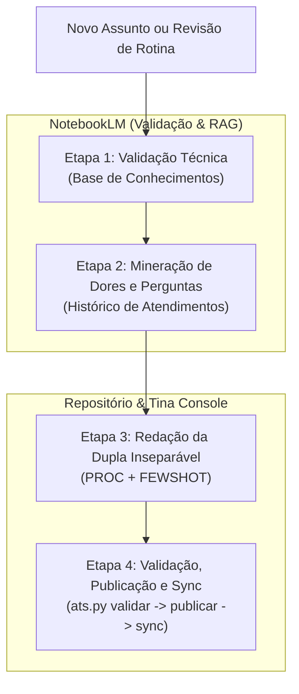

# Curadoria e Enriquecimento de Conhecimento com Gemini Notebook (NotebookLM)

Este guia documenta o fluxo padrão-ouro para auditar, enriquecer e criar procedimentos operacionais (`PROC`) e respostas rápidas (`FEWSHOT`) no ERP Resulth ATS, utilizando os cadernos corporativos do **Gemini Notebook (NotebookLM)** para validação técnica e mineração de linguagem real de clientes.

---

## 1. Os Cadernos Oficiais da ATS no Gemini Notebook

O ambiente conta com dois cadernos corporativos fundamentais, acessíveis via MCP `gemini-notebook-mcp` ou CLI `nlm`:

| Caderno | Notebook ID | Fontes | Finalidade Principal |
| :--- | :--- | :--- | :--- |
| **🎫 Base de conhecimentos com IA - ATS INFORMATICA** | `13cdb6b1-759d-4a52-83ec-56dbfd2ec71a` | 47 fontes | **Validação Técnica:** Manuais oficiais do Resulth, processos completos, telas, menus (`Windows » ...`), regras fiscais e parâmetros de negócio. |
| **📋 Histórico de Atendimentos do Suporte Técnico** | `c308482f-2e83-4986-9d55-10a41081adbe` | 14 fontes | **Mineração de Linguagem Real:** Milhares de atendimentos reais de clientes da ATS, registrando perguntas literais, jargões populares, erros mais frequentes e dúvidas cotidianas. |

### Cadernos Complementares Úteis
- **📋 Resulth Car - Manual de Uso:** `bb43e75d-11d7-40c3-a50d-eab1b059f544` (Módulo automotivo/oficina).
- **☕ NotebookLM do Resulth Web/Java:** `6f3dffad-dc15-48bd-92ed-eece51784c5c` (Retaguarda Web e módulos Java).
- **📜 Manual de Uso do Resulth Windows e Base de Conhecimento:** `f6508269-9158-458b-bb74-5326852e52b6` (Manuais legados do Resulth Windows).

---

## 2. O Ciclo de Enriquecimento em 4 Etapas



---

## 3. Passo a Passo Detalhado da Execução

### Etapa 1: Validação Técnica e Processo Completo
**Objetivo:** Obter a verdade sistêmica sobre como a rotina funciona no ERP Resulth, quais são os menus exatos, pré-requisitos cadastrais e restrições operacionais.

* **Caderno:** `13cdb6b1-759d-4a52-83ec-56dbfd2ec71a` (`🎫 Base de conhecimentos com IA - ATS INFORMATICA`)
* **Ferramenta MCP:** `gemini-notebook-mcp` -> `notebook_query`
* **Template de Consulta Recomendado:**
  ```json
  {
    "notebook_id": "13cdb6b1-759d-4a52-83ec-56dbfd2ec71a",
    "query": "Explique detalhadamente como funciona a rotina de [NOME DA ROTINA / OPERAÇÃO] no ERP Resulth (Windows e Web). Descreva: 1) Qual é o caminho exato de menus no sistema; 2) Quais os pré-requisitos cadastrais e parâmetros necessários; 3) O passo a passo completo da operação; 4) O que o sistema faz por trás (geração de títulos, estoque, movimentação bancária); 5) Regras fiscais e possíveis alertas ou bloqueios."
  }
  ```

---

### Etapa 2: Mineração de Linguagem Real e Perguntas de Clientes
**Objetivo:** Descobrir exatamente como o cliente entra em contato quando precisa dessa rotina, quais termos coloquiais ele utiliza, quais são as dúvidas e erros mais recorrentes.

* **Caderno:** `c308482f-2e83-4986-9d55-10a41081adbe` (`📋 Histórico de Atendimentos do Suporte Técnico`)
* **Ferramenta MCP:** `gemini-notebook-mcp` -> `notebook_query`
* **Template Padrão-Ouro de Consulta:**
  ```json
  {
    "notebook_id": "c308482f-2e83-4986-9d55-10a41081adbe",
    "query": "Como o cliente entra em contato a respeito de [TEMA / ROTINA] e quais as maiores dúvidas deles sobre isso? Cite frases e perguntas reais usadas pelos clientes pfv, termos coloquiais, erros relatados e dificuldades mais comuns reportadas ao suporte técnico."
  }
  ```

* **Elementos a Extrair do Retorno:**
  1. **Frases literais de abertura:** Ex.: *"como lanço um título avulso"*, *"preciso dar entrada numa duplicata de cliente"*, *"renegociação direta sem nota"*.
  2. **Dores e erros cotidianos:** Erros de preenchimento de campos obrigatórios, bloqueios de permissão de usuário, dúvidas sobre qual documento informar, etc.
  3. **Sinônimos e jargões:** Como clientes chamam a tela (ex.: *"entrada simples"*, *"duplicata avulsa"*, *"lançamento avulso"*).

---

### Etapa 3: Redação da Dupla Inseparável (`PROC` e `FEWSHOT`)

Com os dados técnicos da Etapa 1 e a mineração de clientes da Etapa 2, estruture os documentos no padrão do repositório:

#### 1. No Procedimento Operacional (`PROC-*.md`):
* **Vocabulário de Suporte e Gatilhos de Busca (Indexação RAG):** Crie uma tabela cruzando os termos literais minerados com as rotinas sistêmicas. Isso assegura que o RAG da Tina recupere a página mesmo se o cliente usar jargões.
* **Caminhos Exatos de Menus:** Use o menu tradicional completo (ex.: `Windows » Receber » Movimentos Entrada de Documento Simples`).
* **Seção Veja Também (Árvore de Conexões):** Linkar apenas os galhos diretamente conectados (cadastros prévios necessários, rotinas alternativas, próximo passo do ciclo e o arquivo FEWSHOT irmão).

#### 2. No Exemplo de Atendimento (`FEWSHOT-*.md`):
* **Pergunta:** Elaborada com base nas formulações reais mais comuns mineradas no histórico.
* **Resposta Padrão:** Resumo objetivo em até 5 passos numerados executáveis.
* **Seção Mandatória: "Dúvidas Mais Frequentes do Suporte Técnico":**
  * Incluir de 6 a 10 perguntas reais extraídas diretamente do NotebookLM do histórico.
  * Respostas diretas, em parágrafo único, resolvendo a dúvida sem rodeios.
* **Veja Também:** Link espelho apontando diretamente para o slug remoto do `PROC`.

---

### Etapa 4: Validação, Publicação e Sincronização

1. **Blindagem Local:**
   ```bash
   python ats.py validar
   ```
   Garante conformidade de frontmatter YAML, ausência de imagens quebradas no corpo do texto e integridade dos hashes de mídias.

2. **Publicação no Tina Console:**
   Submeter as páginas com `salvar_pagina` via MCP Tina e publicar a versão:
   ```python
   publicar_alteracoes(base="tina", mensagem="Enriquecimento via NotebookLM: [Tema]")
   ```
   *(Ou via pipeline unificado `python ats.py publicar`).*

3. **Sincronização com Google Sheets e Relatório:**
   ```bash
   python ats.py sync
   ```
   Atualiza as **7 abas no Google Sheets** (incluindo `Melhorias e Backlog`) e o arquivo `planilhas/Relatorio_ATS_v3.xlsx`.

---

## 4. Exemplo Real de Aplicação: Entrada de Documento Simples

### Consulta ao Histórico de Atendimentos:
* **Query:** *"Como o cliente entra em contato a respeito de entrada de documento simples - contas a receber e quais as maiores duvidas deles sobre isso ? cite frases e perguntas usadas pelos cliente pfv"*
* **Frases Mineradas:**
  - *"Como lançar um boleto avulso no contas a receber?"*
  - *"Preciso colocar um título de renegociação manual no sistema sem fazer venda, como faz?"*
  - *"Qual a diferença entre Entrada de Documento Simples e Entrada de Documentos Parcelados?"*
  - *"Esqueci de preencher a conta contábil ou centro de custo, posso alterar depois de gravado?"*
* **Resultado:** As dúvidas mineradas foram convertidas diretamente nas 8 perguntas da seção de Dúvidas Frequentes do `FEWSHOT` e nos gatilhos da tabela RAG do `PROC`, elevando a assertividade do agente Tina para 100% no tema.

---

## 5. Diretrizes de Governança: Páginas Analyst e Imagens Faltantes

### A. Auditoria e Aproveitamento de Páginas `audience: analyst`
1. Durante a revisão de fluxos, ao encontrar artigos vinculados marcados como `audience: analyst`:
   - Leia e inspecione a documentação técnica interna.
   - Extraia regras operacionais, parâmetros e tabelas úteis para enriquecer os artigos públicos (`audience: all` / `PROC`).
   - Registre na 7ª aba do Google Sheets (**`Melhorias e Backlog`**) para controle de status e evolução.

### B. Gestão de Imagens Faltantes
1. Nem todas as rotinas ou sub-telas possuem prints disponíveis no momento da criação.
2. **NUNCA invente fotos, nomes de arquivos locais ou hashes falsos.**
3. **Em caso de dúvida ou ausência de imagens de uma rotina, pergunte diretamente ao Paulo Magalhães** para alinhamento.
4. Caso a rotina possa operar com texto puro temporariamente, configure `tem_imagem: false`, `quantidade_imagens: 0`, e adicione um registro de solicitação de prints na aba **`Melhorias e Backlog`**.

### C. Proibição de Menção a Níveis de Suporte (N1, N2, etc.)
1. **Em nenhum documento** (seja `PROC`, `FEWSHOT`, prompt da Tina ou comunicação interna) deve-se citar níveis de suporte técnico ("N1", "N2", "N3", "Tier 2").
2. Referir-se sempre de forma universal e profissional como **"Suporte Técnico"** ou **"equipe de suporte técnico / equipe técnica especializada"**.

### D. Criação a partir de Pastas de Insumos Brutos (Imagens + Transcrições de Vídeo)
1. **Mapeamento Exaustivo de Telas:** Inspecione visualmente 100% das imagens da pasta. Mapeie todos os campos visíveis (mesmo os desmarcados/secundários), colunas nominais de grades, filtros e botões de rodapé.
2. **Leitura da Transcrição:** Leia o arquivo de vídeo transcrito (`*_transcricao.txt`) para capturar termos operacionais e o fluxo ensinado pelo instrutor.
3. **Validação Técnica Inicial no NotebookLM (Título da Tela + Campos):** Use o nome da tela/janela exibido no print e envie em duas partes: 1) o fluxo geral (`"Como é feita a rotina X no ERP Resulth passo a passo?"`); 2) a explicação campo a campo (`"Na tela [Nome da Tela no Print], explique a função de cada campo, filtro, flag e coluna: [lista dos campos]"`). Isso garante explicações práticas e operacionais.
4. **Mineração de Linguagem Real e Dores:** Consulte o caderno do Histórico de Atendimentos (`c308482f...`) para extrair frases literais dos clientes e dúvidas reais sobre a rotina.
5. **Triangulação Mandatória (Loop de Resolução):** Pegue as dúvidas reais mineradas no Histórico e envie-as como novas consultas para o caderno da Base de Conhecimentos (`13cdb6b1...`), obtendo as respostas técnicas definitivas do ERP para cada problema reportado.
6. **Estrutura Completa do `PROC`:** Inclua estimativas de tempo em cada etapa, mapeamento nominal das colunas, botões secundários, mensagem exata de confirmação do sistema, seção de dúvidas respondidas e a verificação de sucesso pós-operação.
7. **Validação Estrutural Local:** Rode `python ats.py validar` para garantir zero erros críticos e ausência de LaTeX `$$`.

