## Árvore de Decisão de Atuação na Base

Ao receber uma demanda neste repositório, identifique imediatamente o tipo de tarefa:

```mermaid
graph TD
    Demanda["Demanda da Base de Dados IA"] --> Tipo{"Qual o objetivo?"}
    
    Tipo -- "Criar / Atualizar Procedimento" --> FluxoA["FLUXO A: Procedimento Operacional (PROC)"]
    Tipo -- "Criar / Ajustar Resposta Rápida" --> FluxoB["FLUXO B: Exemplo de Atendimento (FEW-SHOT)"]
    Tipo -- "Curadoria com NotebookLM" --> FluxoG["FLUXO G: Validação & Mineração (NotebookLM)"]
    Tipo -- "Lacunas da Base (Módulo Nativo)" --> FluxoH["FLUXO H: Gestão de Lacunas da Base (Tina Console)"]
    Tipo -- "Capacitador / Propostas de Melhoria" --> FluxoI["FLUXO I: Capacitador e Propostas Contínuas"]
    Tipo -- "Transbordo & Roteamento de Filas" --> FluxoJ["FLUXO J: Transbordo Inteligente e Regras"]
    Tipo -- "Envio, UX WhatsApp & CSAT" --> FluxoK["FLUXO K: Envio, Nomes e Encerramento"]
    Tipo -- "Subir Imagens / Mídias" --> FluxoC["FLUXO C: Gestão de Mídias no Storage Tina"]
    Tipo -- "Auditar / Publicar / Sincronizar" --> FluxoD["FLUXO D: Publicação MCP, Auditoria e Sheets"]
    Tipo -- "Auditar Chamado Real" --> FluxoE["FLUXO E: Curadoria e Correção de Chamado"]
    Tipo -- "Testes Automatizados" --> FluxoF["FLUXO F: Suíte de Evals e Benchmarking"]
    Tipo -- "Métricas e Relatórios Analíticos" --> FluxoL["FLUXO L: Observabilidade Analítica e Gestão"]

    FluxoA --> A1["Gatilhos RAG + Menus Reais + Regras Fiscais Cautelosas + Chamadas de Mídia"]
    FluxoB --> B1["Pergunta Real + Resposta Concisa 5 Passos + 8 Dúvidas Frequentes de Suporte"]
    FluxoG --> G1["Validação Técnica (Base de Conhecimentos) + Mineração de Dores (Histórico Suporte) -> RAG / PROC / FEW-SHOT"]
    FluxoH --> H1["ai.tina.atsinformatica.com.br/lacunas -> Casos Transferidos -> Rascunho -> Tirar [CONFIRMAR] -> Aprovar"]
    FluxoI --> I1["ver_capacitador -> listar_propostas -> editar_proposta -> aprovar_proposta (Rascunho + Evals)"]
    FluxoJ --> J1["ver_transbordo -> regras por cliente.CODROTA -> definir_pedidos_para_transferir -> simular_transbordo"]
    FluxoK --> K1["configurar_envio (atraso_min_primeira_s) -> configurar_nomes -> configurar_encerramento (CSAT)"]
    FluxoC --> C1["Upload via enviar_midia_base64 -> Capturar Hash Real -> Sincronizar Marcadores [1] a [9]"]
    FluxoD --> D1["salvar_pagina -> alteracoes_pendentes -> publicar_alteracoes -> ats.py sync"]
    FluxoE --> E1["ver_conversa -> revisar_conversa -> marcar_alucinacao -> alterar_status_atendimento"]
    FluxoF --> F1["eval_de_conversa -> salvar_eval -> rodar_evals -> comparar_versao_evals"]
    FluxoL --> L1["relatorio_encerramento -> relatorio_avaliacoes -> relatorio_evolucao -> relatorio_nomes"]
```

---

## 7. As Maiores Dificuldades e Como Superá-las (Lições Práticas)

