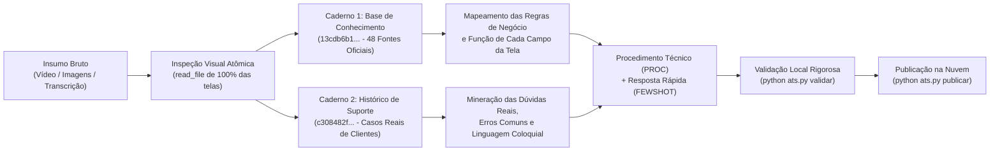

# Tina IA da ATS (Skill Oficial)

[](https://github.com/PauloVictor1803/skill-tina)
[](https://github.com/PauloVictor1803/skill-tina)
[](https://github.com/PauloVictor1803/skill-tina)
[](https://mcp.central.atsinformatica.com.br/tina/mcp)

Skill oficial e completa para gerenciar, auditar, enriquecer, validar e publicar a base de conhecimento operacional, procedimentos técnicos (`PROC`), exemplos de atendimento (`FEWSHOT`), mídias homologadas e rotinas de inteligência artificial no **Tina Console** para o ERP **Resulth ATS** (versões Windows, Checkout e Web).

A skill integra validação técnica assistida por IA, mineração de linguagem real com **Gemini Notebook (NotebookLM)**, sincronização bidirecional em tempo real com o **Google Sheets**, suíte de testes de regressão automatizados (**EVALS**) e um conjunto robusto de **30 Dificuldades Operacionais Homologadas**.

---

## 📑 Sumário

1. [Visão Geral e Objetivo](#1-visão-geral-e-objetivo)
2. [Arquitetura das 101 Ferramentas MCP](#2-arquitetura-das-101-ferramentas-mcp)
3. [Curadoria Dupla com Gemini Notebook (NotebookLM)](#3-curadoria-dupla-com-gemini-notebook-notebooklm)
4. [As 30 Dificuldades Operacionais e Regras de Ouro](#4-as-30-dificuldades-operacionais-e-regras-de-ouro)
5. [Ciclo de Vida de um Conhecimento (Do Insumo à Nuvem)](#5-ciclo-de-vida-de-um-conhecimento-do-insumo-à-nuvem)
6. [Suíte de Testes Automatizados (EVALS)](#6-suíte-de-testes-automatizados-evals)
7. [Estrutura do Repositório](#7-estrutura-do-repositório)
8. [Guia de Comandos da CLI (`ats.py`)](#8-guia-de-comandos-da-cli-atspy)
9. [Instalação e Uso em Ambientes de IA](#9-instalação-e-uso-em-ambientes-de-ia)

---

## 1. Visão Geral e Objetivo

A **Tina** é a assistente virtual e especialista em suporte de primeira linha da ATS Informática. Ela atua diretamente nos canais de atendimento aos clientes e operadores de caixa, solucionando dúvidas diárias sobre:
* **Faturamento e Frente de Loja:** Emissão de NF-e (Modelo 55), NFC-e (Modelo 65), CF-e SAT, contingência EPEC/Offline, devoluções de venda/compra e TEF.
* **Pré-Venda e Expedição:** Emissão de DAVs, reserva de estoque, conferência física e cega de pedidos e despacho logístico.
* **Gestão Financeira e Caixa:** Abertura e fechamento de caixa com conferência cega, sangria, suprimento, liquidação simples e em lote de contas a receber, arquivos de remessa e retorno bancário.
* **Entrada de Mercadorias e Fiscal:** Importação de XML de fornecedores, amarração de CFOP x CST/CSOSN, regras de DIFAL, partilha de ICMS e reforma tributária (IBS/CBS).

### O Papel desta Skill
Esta skill é o cérebro operacional que governa o agente de IA responsável por criar, atualizar e auditar a documentação da Tina. Ela garante que nenhum conhecimento seja publicado com alucinações, informações truncadas, jargões de programação ou comandos de banco de dados proibidos aos clientes finais.

---

## 2. Arquitetura das 101 Ferramentas MCP

A skill conecta o agente diretamente ao servidor oficial da ATS (`https://mcp.central.atsinformatica.com.br/tina/mcp`), abrangendo **101 ferramentas** distribuídas em 11 módulos funcionais:

| Módulo | Qtd | Ferramentas de Destaque | Responsabilidade Técnica |
| :--- | :---: | :--- | :--- |
| **1. Gestão da Base** | 13 | `salvar_pagina`, `ler_pagina`, `arvore_da_base`, `alteracoes_pendentes`, `publicar_alteracoes` | Gerencia o staging de arquivos Markdown, controle de hash anterior para evitar conflitos concorrentes e publicação em lote. |
| **2. Pastas da Base** | 6 | `pastas_da_base`, `criar_pasta`, `mover_pasta`, `renomear_pasta` | Organização hierárquica por módulos (`procedimentos/`, `few-shot/`, `rejeicoes-sefaz/`, etc.). |
| **3. Mídias e Storage** | 8 | `iniciar_envio_midia`, `enviar_midia_chunk`, `concluir_envio_midia`, `listar_midias` | Upload em pedaços (chunking de 500 KB) com geração de hash canônico de 8 caracteres (`*-xxxxxxxx.png`). |
| **4. Auditoria Operacional** | 11 | `auditar_atendimentos`, `revisar_conversa`, `detalhes_conversa`, `desfechos_atendimentos` | Varredura de chamados com notas baixas, transferências precipitadas, feedbacks e identificação de gaps de conhecimento. |
| **5. Capacitador & Propostas** | 10 | `revisar_atendimento`, `criar_proposta`, `aprovar_proposta`, `descartar_proposta` | Pipeline de melhoria assistida: propõe novos procedimentos ou ajustes de regras com base em atendimentos reais. |
| **6. Transbordo Inteligente** | 8 | `atendimentos_em_espera`, `atender_proximo`, `transferir_atendimento`, `assumir_conversa` | Monitoramento da fila humana e transbordo contextualizado sem perda de histórico. |
| **7. Envio, UX e CSAT** | 11 | `enviar_mensagem`, `enviar_midia`, `pesquisa_satisfacao`, `feedback_atendimento` | Gestão da interface do cliente, entrega de imagens no WhatsApp/Webchat e coleta de notas de satisfação. |
| **8. Observabilidade Analítica** | 14 | `analitica_resumo`, `metricas_uso_llm`, `custos_por_modelo`, `tempo_resposta` | Monitoramento de latência, taxa de resolução direta, custos por modelo de LLM e picos de atendimento. |
| **9. Suíte de Evals** | 8 | `salvar_eval`, `rodar_evals`, `listar_evals`, `ver_rodada_eval`, `comparar_versao_evals` | Bateria automatizada de casos de teste para prevenir regressões de prompt, regras ou conteúdo da base. |
| **10. Governança e Versões** | 6 | `listar_versoes`, `criar_versao`, `ativar_versao`, `reverter_versao` | Controle de versionamento semântico do prompt do sistema e rollback seguro. |
| **11. Sincronização Google Sheets** | 6 | `sincronizar_sheets`, `exportar_planilha`, `formatar_grid` | Sincronização bidirecional em tempo real entre a base Markdown e as 7 abas da planilha de governança da ATS. |

---

## 3. Curadoria Dupla com Gemini Notebook (NotebookLM)

Para assegurar 100% de assertividade operacional, a redação e enriquecimento de manuais passam obrigatoriamente por **triangulação entre dois cadernos oficiais** no NotebookLM via CLI `nlm`:



* **Caderno 1 — Base de Conhecimento Oficial (`13cdb6b1-759d-4a52-83ec-56dbfd2ec71a`):**  
  Valida o comportamento padrão do ERP Resulth: menus, caminhos, regras fiscais, parametrizações e mensagens de erro do sistema.
* **Caderno 2 — Histórico de Atendimentos Reais (`c308482f-2e83-4986-9d55-10a41081adbe`):**  
  Minera como o operador e o cliente final falam na prática (perguntas reais, termos informais, atritos diários e erros relatados no Blip e Movidesk), gerando as perguntas das seções de FAQ dos artigos.

---

## 4. As 30 Dificuldades Operacionais e Regras de Ouro

A skill consolida **30 dificuldades práticas e regras invioláveis** homologadas para a operação da Tina. Dentre as mais críticas:

### Dificuldade 29: Inspeção Visual Atômica Obrigatória de Imagens
> [!CAUTION] VITAL: PROIBIDO REDIGIR POR INFERÊNCIA OU APENAS PELA TRANSCRIÇÃO
> Vídeos e áudios omitem campos secundários, nomenclaturas exatas de botões e caixas de seleção que alteram a rotina.
> **O agente DEVE inspecionar 100% das imagens via `read_file`** de cima a baixo, mapeando:
> 1. Título exato da janela na barra do Windows;
> 2. Abas ativas e secundárias;
> 3. Caixas de seleção (marcadas vs. desmarcadas);
> 4. Quadro de unidades e parâmetros de bipagem;
> 5. Colunas de tabelas e instruções de atalho de teclado (ex.: tecla `Delete`);
> 6. Mensagens modais de confirmação ou bloqueio.
> 
> **Envio Obrigatório ao NotebookLM:** A lista nominal dos campos mapeados nas imagens deve ser enviada ao NotebookLM para obter a explicação oficial do que cada elemento faz antes de redigir qualquer parágrafo.

### Dificuldade 30: Autenticação da CLI do Gemini Notebook (`nlm login`) no Windows
* **Gotcha de Permissões no Windows:** Ao rodar `nlm login` em um terminal aberto como Administrador, o Windows salva o arquivo `credentials.enc` com ACL exclusiva e criptografia DPAPI restrita ao token elevado.
* **Sintoma:** O Antigravity ou MCP da IDE (que rodam como usuário comum) sofrem `PermissionError: [Errno 13] Permission denied` e `CorruptCiphertextError`.
* **Regra de Ouro:** Execute `nlm login` **exclusivamente em um terminal de usuário normal**. Caso tenha rodado como Admin, corrija instantaneamente executando:
  ```cmd
  icacls "%USERPROFILE%\.notebooklm-mcp-cli\profiles\default\*" /grant "%USERNAME%":F /T
  ```

### Regras Invioláveis de Segurança e Blindagem
1. **Zero SQL para o Cliente:** É terminantemente proibido fornecer scripts SQL (`SELECT`, `INSERT`, `UPDATE`, `DELETE`), orientar comandos em bancos (Firebird, Postgres, SQL Server) ou citar reparos de corrupção/bugcheck aos clientes. Nesses casos, a orientação é transferir para o Suporte Técnico.
2. **Zero Nomes de Tabelas Físicas:** Não mencione nomes internos de banco (`MOVIMEN`, `MOVIBAN`, `DOCUREC`, `MOVIREC`) em procedimentos voltados aos operadores. Use sempre o nome do campo ou menu que o usuário vê na tela.
3. **Proibição de Níveis de Suporte:** Nunca cite "N1", "N2", "N3" ou "DBA". Refira-se sempre à equipe como **"Suporte Técnico"**.
4. **Padrão Estrito de Formatação:**
   * Proibido fórmulas LaTeX cruas (`$$...$$`);
   * Proibido tags HTML `<kbd>`;
   * Proibido imagens inline soltas (``) — utilize o bloco obrigatório:
     ```markdown
     > [!TIP] Mídia Obrigatória — [Título do Passo]
     > Dispare a ferramenta `enviar_midia` com o ID `[nome-intuitivo-da-midia]`.
     ```

---

## 5. Ciclo de Vida de um Conhecimento (Do Insumo à Nuvem)

```text
1. Insumo Bruto (Vídeo MP4 / Transcrição TXT)
   └── python ats.py extrair-keyframes <video.mp4>
       └── Imagens PNG geradas com nomes intuitivos

2. Upload de Mídias para o Tina Storage
   └── python ats.py upload-midias <pasta>
       └── Hashes canônicos gravados em midia_mapping.json

3. Inspeção Visual Atômica & Mineração no NotebookLM
   └── read_file em 100% das imagens mapeando elementos
   └── Consultas aos cadernos 13cdb6b1... e c308482f...

4. Redação Técnica
   ├── PROC-*.md (Procedimento passo a passo com estimativa de tempo e testes)
   └── FEWSHOT-*.md (Resposta rápida em 5 passos com 8 a 14 FAQs do suporte real)

5. Validação Local Rigorosa
   └── python ats.py validar
       └── Garante 100% de conformidade com frontmatter, mídias e regras visuais

6. Publicação Unificada
   └── python ats.py publicar
       ├── Verificação e renovação de token OAuth
       ├── Sincronização em Staging
       ├── Publicação em lote oficial e indexação vetorial no Tina Console
       └── Sincronização bidirecional com as 7 abas do Google Sheets e Excel local

7. Bateria de Testes Automatizados (Evals)
   └── python ats.py evals --rodar
       └── Execução com validação de assertividade e ausência de regressões
```

---

## 6. Suíte de Testes Automatizados (EVALS)

A suíte de testes da Tina avalia o comportamento real do modelo de LLM ativo em cenários práticos do suporte, pontuando critérios como:
* **Desfecho:** O chamado foi respondido de forma conclusiva ou transferido indevidamente?
* **Páginas Consultadas:** O modelo consultou os procedimentos corretos da base vetorial?
* **Termos Obrigatórios (`deve_conter`):** Palavras-chave e instruções vitais foram fornecidas?
* **Termos Proibidos (`nao_deve_conter`):** A IA evitou jargões internos, SQL ou desculpas automáticas?
* **Empatia e Postura:** Saudação na primeira pessoa, clareza e solicitação de print com tato.

Os testes podem ser executados por caso individual (`caso_id`) ou em bateria completa com múltiplas repetições (`repeticoes: 3`).

---

## 7. Estrutura do Repositório

```text
skill-tina/
├── .agents/
│   └── skills/
│       └── tina-ia-da-ats/
│           ├── SKILL.md                          # Instrução mestra da skill (árvore de decisão)
│           ├── agents/
│           │   └── openai.yaml                   # Metadados e interface do agente
│           ├── assets/
│           │   └── tina-base-ia.svg              # Diagramas visuais da arquitetura
│           └── references/
│               ├── mcp-tina-console.md           # Documentação completa das 101 ferramentas MCP
│               ├── curadoria-notebooklm.md       # Roteiro de triangulação nos cadernos oficiais
│               └── gotchas-e-dificuldades.md     # Guia detalhado das 30 dificuldades operacionais
├── .codex/
│   └── skills/
│       └── tina-ia-da-ats/                       # Espelho para ambientes Codex
├── .gitignore                                    # Proteção de credenciais, logs e temporários
└── README.md                                     # Este manual completo
```

---

## 8. Guia de Comandos da CLI (`ats.py`)

No diretório de trabalho da base de dados (`Base de dados IA - ats`), o arquivo `ats.py` fornece os atalhos para todas as operações do ciclo de vida:

| Comando | Descrição |
| :--- | :--- |
| `python ats.py check-token [-r]` | Verifica o status do token OAuth da Central ATS e auto-renova via refresh_token. |
| `python ats.py auth-tina` | Abre o servidor local e o navegador para novo fluxo completo de login na Central. |
| `python ats.py validar` | Executa a validação estrita em todas as pastas de procedimentos locais. |
| `python ats.py extrair-keyframes <video.mp4>` | Extrai automaticamente as telas do ERP a partir de vídeos via ffmpeg. |
| `python ats.py upload-midias <pasta>` | Realiza o upload das imagens para o Tina Storage com cálculo de hash canônico. |
| `python ats.py publicar [--mensagem "..."]` | Pipeline unificado: valida, envia para staging, publica na nuvem e sincroniza o Sheets. |
| `python ats.py sync` | Sincroniza as 7 abas do Google Sheets oficial com a base local e gera a planilha Excel. |
| `python ats.py formatar` | Padroniza altura de linhas (50px) e elimina colunas excedentes no Google Sheets. |
| `python ats.py evals [--rodar]` | Lista todos os casos de teste cadastrados ou dispara a bateria automatizada de evals. |
| `python ats.py criar-eval <conversa_id> [--salvar]` | Converte um chamado auditado em caso de teste na suíte de evals. |
| `python ats.py revisar <conversa_id>` | Executa revisão assistida por IA de um atendimento com diagnóstico e sugestões. |
| `python ats.py lacunas [--previa\|--analisar]` | Consulta a prévia ou dispara a mineração de lacunas a partir dos chamados do suporte. |
| `python ats.py limpar` | Remove travas de arquivos temporários e caches da raiz. |

---

## 9. Instalação e Uso em Ambientes de IA

### Google Antigravity IDE
Para disponibilizar a skill globalmente no Antigravity:
1. Copie a pasta `tina-ia-da-ats` para o diretório de skills de configuração:
   ```cmd
   xcopy /E /I "skill-tina\.agents\skills\tina-ia-da-ats" "%USERPROFILE%\.gemini\config\skills\tina-ia-da-ats"
   ```
2. O assistente carregará a skill automaticamente ao interagir com procedimentos da Tina ou executar o comando `/tina-ia-da-ats`.

### Codex CLI
Para disponibilizar no Codex:
```cmd
xcopy /E /I "skill-tina\.codex\skills\tina-ia-da-ats" "%USERPROFILE%\.codex\skills\tina-ia-da-ats"
```

---

## 📄 Licença e Confidencialidade
Material exclusivo e homologado para a operação de Suporte e Inteligência Artificial da **ATS Informática**.  
Todos os direitos reservados.
